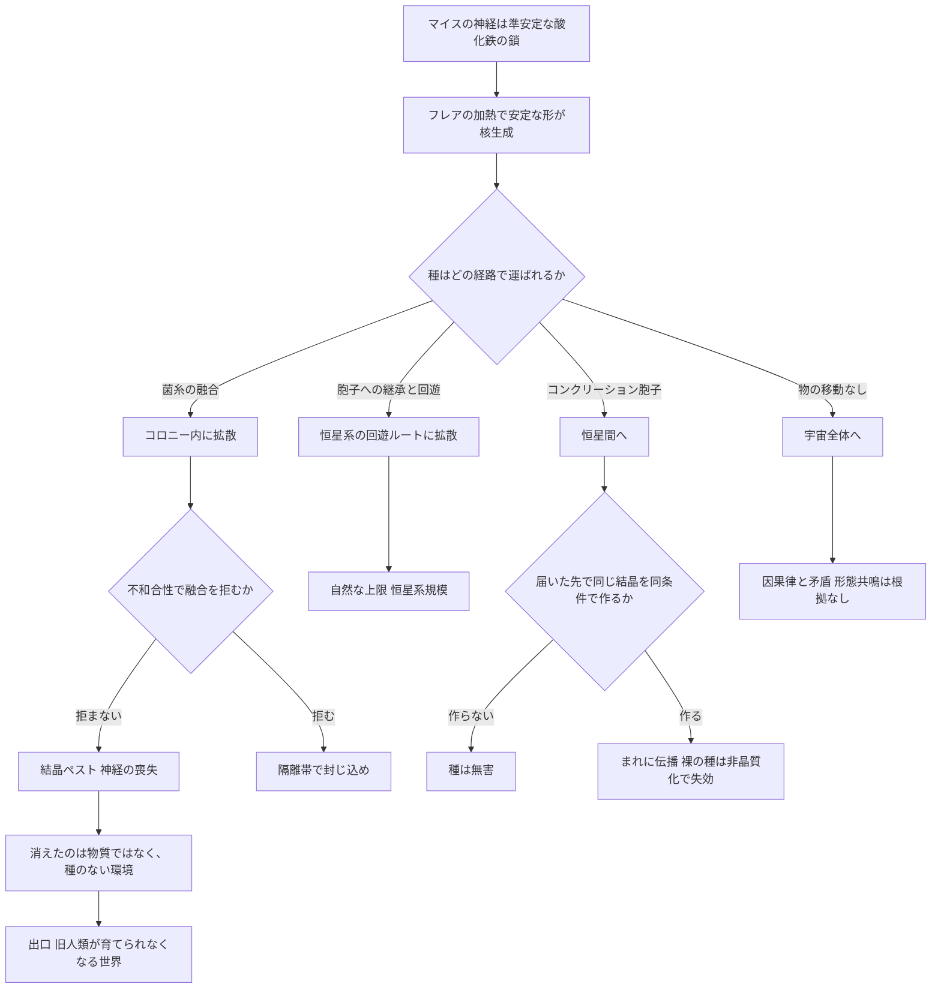

## 1. 概要 (Abstract)

製薬の現場には「**消えた多形**」と呼ばれる現象がある。
ある薬を何年も同じ結晶形で作っていたのに、ある日、より安定な別の結晶形が現れる。
すると、その新しい形の目に見えないほど小さな「種」が工場や研究所に広がり、もとの結晶形がどうしても作れなくなってしまう。

コズミックマイス（[g134](../../glossary/terms/g134.md)）も、体の中で結晶を作る生命体として描かれてきた。
菌糸の細胞壁に並ぶマグネタイトのナノ結晶の鎖は、速い信号を運ぶ「神経」の役割を担う（[wiim_100](wiim_100.md)）。
胞子は鉱物の殻に包まれて星間を渡るとされる（[wiim_117](wiim_117.md)）。

本記事が問うのは次の2点である。
**もしコズミックマイスのどこかで、より安定な結晶形が一度でも生まれたら、その種は菌糸網・胞子・回遊ルートを伝って広がり、マイス全体で元の結晶が作れなくなるのか。**
**起きるとしたら、それはコロニー規模、小天体規模、恒星系規模、恒星間規模、宇宙規模のどこまで広がるのか。**

結晶多形と準安定の基本は、補遺 [同じ元素、別の物質——結晶多形](../notes/crystal_polymorphs.md) にまとめてある。

---

## 2. 実現不可能性の根拠 (Infeasibility Rationale)

### 物理的限界

**「消えた多形」は物理法則の変化ではなく、汚染である。**
新しい結晶形が現れても、元の結晶形が物理的に作れなくなるわけではない。
元の形が作れなくなるのは、溶液や工場の中に新しい形の微小な種が紛れ込み、結晶ができ始める瞬間（核生成）を横取りしてしまうからだと考えられている。
実際、医薬品の事例でも、種を厳密に取り除いた条件では元の結晶形が再び得られたと報告されている。
したがって広がる範囲は、**種がどこまで運ばれ、どれだけ長く種として働き続けられるか**で決まる。

**種は旅の途中で壊れる。**
星間空間に漂う塵のうち、ケイ酸塩の大部分は結晶ではなく、原子の並びが崩れた非結晶（非晶質）の状態で見つかっている。
宇宙線や高温のガスが、長い時間をかけて結晶の並びを崩していくためだと考えられている。
裸の結晶の種は、恒星間を渡るあいだに「種としての形」を失う可能性が高い。

**「より安定」は条件によって入れ替わる。**
どちらの結晶形が安定かは、温度・圧力・粒の大きさで変わる。
北海道大学の研究では、普通は存在しない単純立方の銀がナノ粒子では保たれる例が報告された。
酸化鉄でも、ナノサイズでは表面の影響で準安定な形が有利になりうると指摘されている。
マイスの結晶は数ナノメートルの粒なので、ある宙域では「新しい形が安定」でも、別の宙域では「元の形が安定」ということが起こりうる。

### 技術的限界

**生物の結晶は、膜の中で作られる。**
磁性細菌は、マグネタイトの結晶を膜で囲まれた小部屋の中で作り、専用のタンパク質で並び方を選ばせている。
貝殻も、準安定なあられ石を、タンパク質の足場の上で選んで作っている。
つまり生物の結晶づくりは、工場よりも外からの種に強い。
外から結晶の種が入り込むには、その小部屋の中まで運ばれなければならない。
しかし菌類は、養分を体の外で溶かしてから吸収するので、外から来た種の多くは取り込まれる前に溶けてしまうと考えられる。

**種が伝わる経路は限られる。**
種が溶けずに届く経路は、次の2つにほぼ限られる。

- **菌糸どうしの融合**：つながった菌糸のあいだでは細胞質がそのまま行き来するので、結晶の粒も一緒に運ばれる
- **親から胞子へ**：胞子は親の細胞質の一部を受け継ぐ

どちらも生きた組織のつながりに沿った経路であり、塵のようにどこへでも舞うわけではない。

**菌類はすでに「隔離の仕組み」を持っている。**
実在の菌類 *Podospora anserina* には、HET-s というプリオン（形が形を写すタンパク質）がある。
このプリオンを持つ菌糸が、相性の悪い別の菌糸と融合すると、融合した部分の細胞が自ら死んで、つながりを断つ。
「異核共存不和合性」と呼ばれるこの仕組みは、他の個体の細胞質が入り込むのを防ぐ、菌類の防疫装置と見ることもできる。
コズミックマイスが同じ仕組みを持つなら、汚染は融合の段階で止められる可能性がある。

### 論理的限界

**「宇宙のどこでも作れなくなる」には、離れた場所への即時の作用が要る。**
もし、どこかで新しい結晶形が一度できただけで、種が届いていない遠い宙域でも元の形が作れなくなるとしたら、それは「結晶の形の情報が、物の移動なしに宇宙全体へ伝わる」ことを意味する。
これは光より速く情報を伝えることに等しく、因果律と両立しない。
「一度生まれた形は、どこかで記憶されて世界中に影響する」という主張は「形態共鳴」として知られているが、科学的な裏づけはない。
したがって宇宙規模の「消えた多形」は、現実の物理の延長では成り立たない。

**「完全に消える」ことも証明できない。**
元の形を作れる場所が宇宙のどこか1か所でも残っていれば、それは「消えた」ことにならない。
逆に、すべての場所で消えたことを確かめるには、すべての場所を調べる必要がある。
「消えた多形」は、あくまで観測できる範囲での経験的な現象にとどまる。

---

## 3. 実験の設定 (Setup)

- **主体:** 生体マグノニクスを獲得したコズミックマイスの系統（[wiim_100](wiim_100.md)）。菌糸の細胞壁に、直径5〜10nmの酸化鉄ナノ結晶が鎖状に並ぶ。
- **前提とする結晶:** 宇宙環境での酸化を受けて、この系統の鎖はマグネタイトから**マグヘマイト**（強い磁性をもつ酸化鉄の準安定な形）へ移った状態で安定化している、と仮定する。マグヘマイトと**ヘマタイト**は同じ組成の酸化鉄で、並び方だけが違う。ヘマタイトは通常の条件ではより安定だが、磁性が非常に弱く、スピン波の導波路にはほとんど使えない。
- **出来事:** 小惑星帯のあるコロニーで、強い太陽フレアによる加熱をきっかけに、鎖の一部がヘマタイトとして生まれる。
- **伝達経路:**
  1. 菌糸の融合による細胞質の移動
  2. 親から胞子への継承
  3. 回遊ルート（[wiim_026](wiim_026.md)）に沿ったシェルマイセリウム（[wiim_025](wiim_025.md)）の移動
  4. コンクリーションに包まれた胞子による恒星間輸送（[wiim_117](wiim_117.md)）
- **比較する規模:** コロニー → 小天体 → 恒星系 → 恒星間 → 宇宙全体

---

## 4. 考察と予測 (Speculation)

### 段階則が示す「準安定な神経」

結晶ができるときは、いきなり最も安定な形になるのではなく、まず準安定な形を経由しやすい。これをオストワルトの段階則と呼ぶ。
磁性細菌でも、マグネタイトは別の鉄の化合物を経由して作られると報告されている。
生物は、この「途中の形」を膜の中で固定し、役に立つ性質だけを取り出していると見ることができる。

コズミックマイスの「神経」も、**準安定な形をあえて保つことで成り立っている**と考えられる。
そうであれば、より安定な形の種は、神経そのものを崩す病原体のように働く。

### 規模ごとの予測

| 規模 | 種は届くか | 予測 |
|------|-----------|------|
| **コロニー** | 菌糸融合で細胞質ごと運ばれる | 最も起きやすい。融合がつながっている範囲では、ヘマタイトの種が新しく作られる鎖の結晶づくりに入り込み、神経が少しずつ置き換わっていくと考えられる |
| **小天体** | コロニー間の菌糸のつながり次第 | つながりの密な小天体では全体に広がる。不和合性で融合を拒むコロニーがあれば、そこで止まる |
| **恒星系** | シェルマイセリウムの回遊と胞子の継承で運ばれる | 年から数十年の単位で、回遊ルートに沿って広がる可能性がある。**ここが自然な上限**と考えられる |
| **恒星間** | 胞子はコンクリーションに守られるが、旅は数千年から数百万年 | ねじれが生じる。種は生きている必要がないので、胞子が死んでも、殻の中で守られた結晶の種だけは届きうる。ただし、届いた先のマイスが同じ酸化鉄を同じ条件で作っていなければ何も起きない。裸の種は旅の途中で非結晶に崩れる |
| **宇宙全体** | 届かない | 現実の物理では起きない（論理的限界を参照） |

### 結晶ペスト——神経を失う菌糸網

ヘマタイトへの置き換わりが進んだコロニーでは、スピン波の速い回線が使えなくなる。
コロニーは電気化学的な遅い信号だけに頼ることになり、[wiim_083](wiim_083.md) で論じられた「コロニーの半径に限界がある」問題がよみがえる。
外縁で起きたことを中心が知るまでに何時間もかかる、反応の鈍いコロニーに戻ると考えられる。

マイスにとって、これは死ではなく**認知の退化**である。
個々の菌糸は生きているのに、群れとしての速い思考が失われていく。
この状態を「結晶ペスト」と呼ぶことにする。

### マイスの防疫行動

群知性としてのマイスが汚染を「認識」できるなら、次のような行動がとられると予想される。

- **融合の拒否**：汚染されたコロニーとの菌糸融合を、不和合性の仕組みで拒む。HET-s のように、つながった部分を自ら死なせて切り離す
- **隔離帯**：汚染域の周りの菌糸を枯らし、細胞質が行き来できない空白の帯を作る
- **回遊ルートの変更**：汚染された小天体を避けて回遊する。何世代もの回遊のあとには、「近づいてはいけない宙域」が地図として残るかもしれない
- **環境の切り替え**：ナノサイズの効果や温度で安定性の順番が入れ替わる宙域へ移り、元の結晶形が有利な条件を取り戻す

### 「消えた」のは結晶ではなく、作り方である

ここまでの議論から、消えた多形の本質は「物質が消えること」ではなく、**ある形を作れる環境が、種で埋め尽くされること**だと言える。
元の形を作る遺伝的な能力は残っている。失われたのは、それを発揮できる「種のない場所」のほうである。

この構図は、結晶に限らない。
生まれたときから周囲に満ちている「種」によって、どう育つかが決まってしまう存在すべてに当てはまる。
シェルマイセリウムの中で育つ人間の世代に、菌糸と意思を通わせる感応者（マイセリアン、[g299](../../glossary/terms/g299.md)）が現れるという設定も、同じ見方で読み直せる。
もし感応者を生む「種」が人類の生活圏を満たしたら、感応しない旧来の人間は、遺伝的には滅びていないのに、もう育てられなくなるのではないか。
この出口側の問いは、補遺 [旧人類が育てられなくなる世界](../notes/wiim_150_old_humanity.md) で扱う。

---

## 5. 図解 (Diagrams)

---

## 6. 関連記事 (Related)

- [g134](../../glossary/terms/g134.md) — コズミックマイス
- [g299](../../glossary/terms/g299.md) — マイセリアン（感応者。出口側の主題）
- [wiim_100](wiim_100.md) — コズミックマイスの生体マグノニクス（汚染の標的となる「神経」）
- [wiim_117](wiim_117.md) — コンクリーション・コクーン（恒星間で種を運びうる殻）
- [wiim_026](wiim_026.md) — コズミックマイスのテラフォーミング（回遊ルートと種の拡散経路）
- [wiim_083](wiim_083.md) — 疑似ルーネベルク構造（神経を失ったときに戻ってくる半径の限界）
- [wiim_129](wiim_129.md) — 胞子は電荷だけで恒星間空間へ渡れるか
- [補遺：同じ元素、別の物質——結晶多形](../notes/crystal_polymorphs.md) — 準安定と消えた多形の基礎
- [補遺：コズミックマイスをめぐる信仰と社会](../notes/cosmic_myce_religion.md) — 感応者の社会的立場
- [補遺：旧人類が育てられなくなる世界——感応者への静かな代替わり](../notes/wiim_150_old_humanity.md) — 本記事の出口
