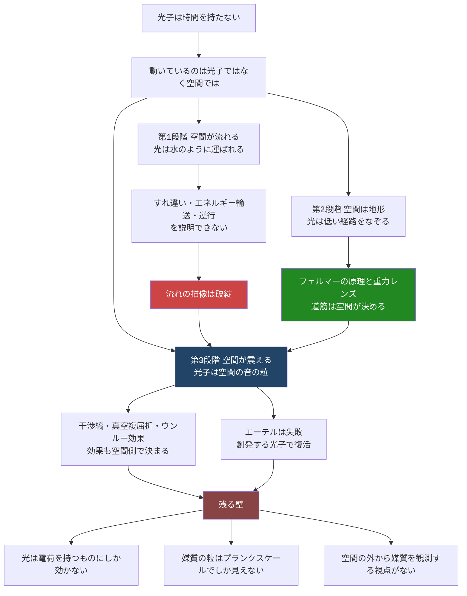

## 1. 概要 (Abstract)

「光子は時間を持たない」とよく言われる。光の速さで進むものにとっては時計が進まず、宇宙の端から端までの旅も「一瞬」だ——という説明である。だが、もし光子の側で何も経過しないのなら、本当に「動いている」のは光子なのだろうか。動いているのはむしろ空間の側で、光が引き起こすさまざまな効果も、その原因は光子ではなく空間にあるのではないか。

本記事ではこの直感を、次の三段階の仮説として順に検討する。

1. **流れ:** 空間が水のように流れ、光はそれに乗って運ばれているだけである。
2. **地形:** 空間は光を導く地形であり、光は水のように「低い経路」をなぞって進む。
3. **音:** 空間そのものが震えており、光子はその揺れの最小単位——空間の「音の粒」——である。

> **前提:** 光が及ぼす効果（干渉・エネルギーの受け渡し・電磁場の励起）の原因を、光子ではなく空間の側に置く。
> **命題:** 「光は空間を通り抜けていく『物』ではなく、空間そのものが震える『音』なのではないか？　そうだとしたら、その媒質としての空間を私たちは確かめられるのか？」

第1段階は早い段階で破綻し、第2段階は半分だけ成り立つ。本記事の主題は、最も踏み込んだ第3段階「光は空間の音である」という仮説が、なぜ検証不可能なのかにある。

---

## 2. 実現不可能性の根拠 (Infeasibility Rationale)

ここでは最終段階の仮説「空間が震えており、光子はその揺れの最小単位である」を対象に論じる（第1段階「流れ」の破綻は第4節で扱う）。

### 物理的限界

**光は一部の物質にしか効かない。** 空間の形である重力は、あらゆる物質に等しく作用する（等価原理）。ところが光、すなわち電磁場の揺れは、電荷を持つものにしか作用しない。ニュートリノは光を素通りし、電荷を持たない粒子は光に押されない。もし光が空間そのものの震えなら、なぜ一部の物質だけがその震えを感じるのかを説明しなければならない。空間の形（重力）と空間の音（光）が、物質に対してまったく違う選び方をしているという非対称性は、この仮説にとって最も大きな壁だと考えられる。

**光は1か所で1個ずつ受け取られる。** 光電効果では、空間全体に広がった揺れが、ある一点で決まった量のエネルギーとしてまとめて受け取られる。空間を原因とする描像でもこれを説明するには、空間の揺れを量子化（最小単位に区切ること）する必要がある。そしてその最小単位こそが光子である。つまりこの仮説は光子を消し去るのではなく、光子を「空間の揺れの最小単位」として呼び直すことになる。

**「媒質の粒」の痕跡が見つかっていない。** 音を伝える空気や結晶は、細かく見れば原子という粒でできている。そのため波長が原子の間隔に近づくと、音の速さは波長によって変わり始める。光が空間の音なら、きわめて高いエネルギーの光で同じ「ずれ」が現れるはずだ。だが遠方のガンマ線バーストで高エネルギーの光と低エネルギーの光の到着時刻を比べた観測では、ずれは見つかっておらず、エネルギーに比例する単純なずれについては、プランクスケール（量子重力が効くと考えられる極小の尺度）に相当する水準まで否定されている。

### 技術的限界

**媒質の「風」を測る装置が作れない。** 音の速さは風上と風下で変わるため、空気の流れは音で測れる。だが一般相対性理論では、時空をどんな座標で描いてもよく、「空間が流れている」と描いても「空間は静止している」と描いても同じ予言が出る場合がある。測定できるのは座標の選び方によらない量だけであり、「空間という媒質がどちらへどれだけ動いているか」を直接測る装置は、現在の物理の枠内では設計できない。

**媒質の粒の細かさに手が届かない。** 媒質の粒が見えてくるとすれば、それはプランクスケール付近だと予想される。そこに直接届く粒子加速器は、地球規模どころか銀河規模の装置でも足りないと見積もられる。手がかりは遠方天体から偶然届く高エネルギーの光に限られ、条件を自由に変えて試す実験は組めない。

### 論理的限界

**光子の視点は存在しない。** 「光子は時間を持たない」という出発点自体に落とし穴がある。光速で進むものには静止系がなく、「光子の立場から見た世界」は定義できない。光の経路に沿った固有時間（その物体自身の時計の進み）がゼロになるのは事実だが、それは「光子の時計が止まっている」のではなく、「光子に時計を持たせる手続きが成立しない」という意味だと解釈される。存在しない視点を足場にして「だから空間が動いている」と結論することはできない。

**空間の外から空間を見る視点もない。** 実験室の音響ブラックホールでは、流れる水を外から眺める実験者がいる。だが私たちの時空の「媒質」を外から観測しようとしても、観測者自身と観測装置がその媒質の一部であり、その揺れによって情報を受け取っている。測る側が測られる側に含まれているため、媒質そのものを対象化できない。

**何でも空間のせいにすると反証できなくなる。** 光の効果も重力も物質も「空間の性質」とすると、空間という言葉は「存在するものすべて」の別名になってしまう。他の描像と異なる予言を出せない限り、この仮説は検証可能な理論ではなく言い換えにとどまる。

---

## 3. 実験の設定 (Setup)

1. **主体:** 光（光子）。遠方の恒星から地球へ届く一本の光線を追う。
2. **環境A（平坦な時空）:** 重力源のない真空。光は直進する。
3. **環境B（重力場）:** 太陽や銀河団の近く。光は重力レンズ効果によって曲がる。
4. **環境C（ブラックホール）:** 事象の地平線を持つ時空。地平線の内側からは光が出てこられない。
5. **環境D（実験室のアナログ）:** 流れる水や超低温原子気体の中に作った「音のブラックホール」（音響ブラックホール）。流れが音速を超える領域から、音は上流へ戻れない。
6. **環境E（二重スリット）:** 二本の細いスリットに、光子を1個ずつ間隔をあけて送り込む。
7. **操作:** それぞれの環境について、「光が動く」「空間が流れる」「空間が地形として光を導く」「空間が震える」の各描像で同じ現象を記述し、どこまで自然に説明できるかを比べる。

---

## 4. 考察と予測 (Speculation)

### 第1段階：空間が流れる——水のたとえは破綻する

光が「空間の流れ」に乗っているだけだとすると、すぐに三つの事実と衝突する。

- **光はすれ違える。** 同じ場所を右向きの光と左向きの光が同時に通過しても、互いを素通りする。川の水は一点で一方向にしか流れられない。
- **光はエネルギーを運ぶ。** 光電効果では光が電子を叩き出し、太陽光は宇宙機の帆を押す。光源から吸収体へエネルギーを運んでいるものがある。
- **光の経路は逆にたどれる。** A から B へ進める経路は、B から A へも進める（事象の地平線をまたぐ経路だけは例外で、内向きにしか通れない）。坂を下った水が自然に登り返すことはない。

ブラックホールを「空間が中心へ流れ落ちる川」として描く**川モデル**（ガルストランド＝パンルヴェ座標に基づく描像）では、事象の地平線は川の流れがちょうど光速に達する場所として説明され、「空間が流れる」描像が驚くほどよく機能する。だがこのモデルでさえ、**光は川に対して光速で泳いでいる**。空間が流れても光が止まるわけではなく、「光が動く」描像を流れる舞台の上に乗せ直しただけになる。

### 第2段階：空間は地形である——「低い経路」は半分正しい

光の経路には古くから美しい性質が知られている。**フェルマーの原理**——光は、通過にかかる時間が極値（多くの場合は最短）になる経路を通る。弱い重力場の中では、時空の歪みを「場所によって屈折率が変わる透明な物質」に置き換えて計算でき、重い天体の近くほど屈折率が高くなる。光はそちらへ曲がり込む——これが重力レンズだ。

光は確かに重力ポテンシャルの「深い」ほうへ曲がり、窪みへ回り込む水によく似ている。ただし水は摩擦でエネルギーを失って窪みに溜まるが、光はエネルギーを失わずに縁を回り込み、通り抜けていく。光は地形を**流れ下る**のではなく、地形を**なぞっていく**。ここで重要なのは、光の道筋を決めているのが光子の側ではなく、空間の側だという点である。

### 第3段階への橋：空間が光を通す

道筋だけでなく、光の効果そのものも空間の側で決まっているように見える現象がある。

- **干渉縞は空間の形で決まる。** 二重スリットに光子を1個ずつ送っても、多数集まると縞模様が現れる。縞の間隔はスリットの幅と間隔、つまり空間の形で決まる。光子は「どこで検出されるか」のきっかけを与えるだけで、模様そのものは経路の構造が描いている、と読むことができる。
- **真空は受け身ではない。** 量子電磁力学によれば、強い磁場の中の真空は偏光の向きによって光を異なる速さで通す（真空複屈折）。中性子星の観測でその兆候が報告され、光と光が真空を介して散乱する現象も加速器実験で確認されている。何もないはずの空間が、光に対して物質のように応答している。
- **光子の数は観測者によって変わる。** ウンルー効果によれば、慣性系の観測者にとっての真空は、一定の加速度で運動する観測者には熱放射で満ちて見えると予言される。光子が「そこにある」かどうかは観測者に依存し、より基本的なのは空間に広がる場の状態のほうだという解釈が示唆される。

ここまで来ると、光は「空間を通り抜けていく物」ではなく、「空間が自分の状態を伝えていく現象」に近づく。

### 第3段階：光は空間の音である

音を考えてみる。沖から岸へ波が届いても、海水が沖から岸まで運ばれてくるわけではない。空気中の音も同じで、動いていくのは空気ではなく揺れのパターンだ。そして**揺れはすれ違える**——第1段階で「流れ」を破綻させた三つの事実は、「音」に置き換えるとすべて素直に説明できる。揺れは重なり合っても互いを素通りし、エネルギーを運び、逆向きにも伝わる。

結晶の中の音は、量子力学では**フォノン**（音子）という最小単位で扱われる。フォノンは独立した「物」ではなく、結晶全体の集団的な揺れであり、**準粒子**と呼ばれる。光子が空間の音の最小単位だとすれば、光子は「真空のフォノン」——空間という媒質の準粒子——ということになる。

この発想は、物理学の歴史で二度、真剣に検討されてきた。

**一度目：19世紀のエーテル（失敗）。** 光を「エーテルという弾性体を震わせる音」とみなす試みは、二つの点で行き詰まった。ひとつは風の問題で、エーテルの流れがあれば方向によって光速が変わるはずだが、マイケルソン＝モーリーの実験ではどの方向にも同じだった。もうひとつは揺れ方の問題で、弾性体の音には横に揺れる横波のほかに、押し縮める縦波が必ず含まれる。光には横波しかなく、縦波だけを消す弾性体はうまく作れなかった。

**二度目：現代の「創発する光子」（研究継続中）。** 量子的にもつれた格子の中では、集団的な揺れとして横波だけを持つ「光子」が自然に現れることが示されている（ストリングネット凝縮）。19世紀に解けなかった「縦波を消す」問題が、量子のもつれによって解けるのだ。また超流動ヘリウムの中の揺れは、低いエネルギーでは相対論とそっくりに振る舞い、内部の観測者には「風」が測れないことも指摘されている。媒質の音であっても、媒質の中にいる者には媒質が見えない——エーテルの失敗は、エーテルが存在しない証拠ではなく、内側からは見えない証拠だったのかもしれない。

さらに、電磁気そのものを空間の形として書き直す理論もある。**カルツァ＝クライン理論**では、小さく丸まった5番目の次元を加えると、電磁場がその次元の「ねじれ」として現れ、電荷はその方向の運動量になる。第2節で挙げた「なぜ光は電荷を持つものにしか効かないのか」に対する、ひとつの答えの形である。ただしこの理論は、予言される粒子の質量や粒子の左右非対称性が観測と合わないという問題を抱えており、そのままの形では成立していない。

### 結論：光子は消えず、名前を変える

三段階をたどった結果、出発点の直感は次のように整理できると考えられる。

- 光は空間を**流れる水**ではない。
- 光の道筋は空間の**地形**が決めている。
- 光は空間に広がる場の**揺れ**であり、その揺れの最小単位が光子である。光子が空間という媒質の「音の粒」であるかどうかは、媒質の粒が見えるほどの高エネルギーに届かない限り確かめられない。

「動いているのは光子ではない」という直感は、「動いているのは物ではなく揺れである」という形で正しい。一方「すべての原因は空間にある」と言い切るには、光が電荷を持つものにしか効かないという非対称性を、空間の言葉で説明しきる必要がある。

### 残る問い

- 光が空間の音なら、重力波——空間の形そのものの揺れ——は何にあたるのか。音と、音を伝える床のたわみを、内側の観測者は区別できるのか。
- 「光の側では時間が経たない」のであれば、光が「経験する」宇宙は始点と終点が接した一つの点なのか。それとも静止系を持たないものには「経験」という概念自体が当てはまらないのか。
- フォノンが結晶の外では存在できないように、光子も「この空間」の外では存在できないのか。もし別の宇宙の空間があるなら、そこを震わせる音は私たちの光と同じなのか。

---

## 5. 数式による表現 (Mathematical Notation)

弱い重力場は、光にとって場所ごとに屈折率の異なる媒質として近似できる。

$$n(r) \approx 1 + \frac{2GM}{rc^2}$$

ここで $M$ は天体の質量、$r$ は天体の中心からの距離、$G$ は重力定数、$c$ は光速である。天体に近いほど（$r$ が小さいほど）屈折率 $n$ は 1 より大きくなり、遠方の観測者から見た光の進みは遅くなる。光はフェルマーの原理に従って屈折率の高い側へ曲がり込み、これが重力レンズの曲がり角を正しく与える。「空間は光にとっての透明な地形である」という第2段階の描像を、最も簡潔に表した式だと言える。

なお、この式は重力が弱い領域で特定の座標（等方座標）を選んだときにだけ成り立つ近似である。ブラックホール近傍のような強い重力場では使えず、また「遅くなる」のは遠方の観測者の座標で測った光の速さであって、その場にいる観測者が手元で測れば光速は常に $c$ になる。

---

## 6. 図解 (Diagrams)

---

## 7. 関連記事 (Related)

- [光速突破は時空を"破断"させるか（wiim_118）](wiim_118.md) — 空間を因果順序として捉え直した記事。空間を「物」ではなく構造として見る点で本記事の土台になる
- [星は銀河の歌を聞くが、隣の星の歌は聞こえない（wiim_101）](wiim_101.md) — 宇宙を伝わるさまざまな「音」と、スケールによる聞こえ方の違いを論じた記事
- [音をブラックホールに折り畳み、ワームホールから取り出せるか（wiim_102）](wiim_102.md) — 音響ブラックホールを含む、音と重力の類推を扱った記事
- [物質とエネルギーは作用に還るか（wiim_141）](../physics/wiim_141.md) — 質量を「固有時間が刻まれる速さ」として捉えた記事。固有時間がゼロの光は、その裏返しの存在として位置づけられる
- [時間の外への退避（wiim_145）](../quantum/wiim_145.md) — 「何も経たずに戻る」状態を量子論の側から問う記事。光子の固有時間ゼロとの対比で読める
- [エバネッセント波の超光速（wiim_112）](wiim_112.md) — 「光速を超えて見える波」の正体を、位相・群・信号の速さの区別から論じた記事
- [光速を超えた場合の因果律（wiim_001）](wiim_001.md) — 光速が因果律の上限であることの帰結を扱った記事
- 用語: 固有時間 g174 / 測地線 g296 / フェルマーの原理 g297 / 重力レンズ g075 / 音響ブラックホール g405 / QED g541 / 真空複屈折 g543 / ウンルー効果 g544 / フォノン g365 / 準粒子 g548 / 等価原理 g549
- 未作成の関連概念: 光円錐、ガルストランド＝パンルヴェ座標（川モデル）、重力場の実効屈折率、エーテル仮説とマイケルソン＝モーリーの実験、ストリングネット凝縮、カルツァ＝クライン理論
