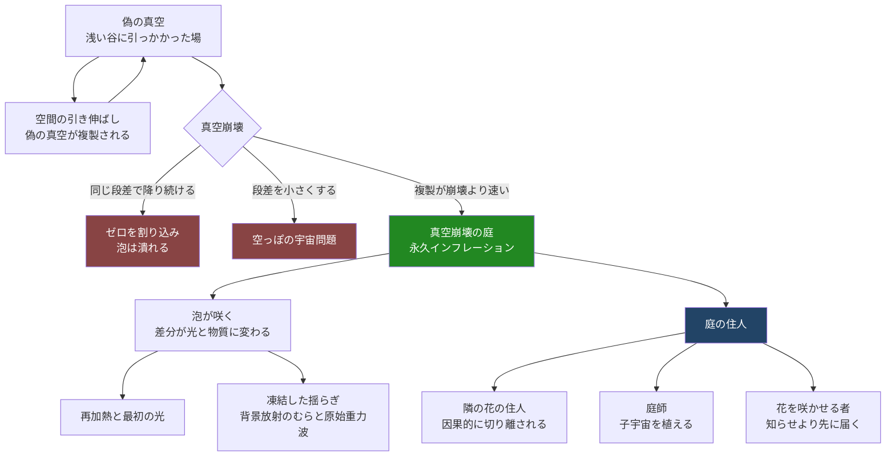

## 1. 概要 (Abstract)

[wiim_147](../quantum/wiim_147.md) では、時間を持たない光が、時間による変化から生まれることを見た。では宇宙で最初の光は、どんな変化から生まれたのか。

有力な答えは、**偽の真空**が崩れる変化である。宇宙の最初期、空間は偽の真空——場のエネルギーの地形で、途中の浅い谷に引っかかった状態——によって急激に引き伸ばされ（インフレーション）、その引っかかりが外れたとき、蓄えられていたエネルギーが光と物質に変わったと考えられている。

偽の真空には奇妙な性質がある。空間が引き伸ばされても、そのエネルギーは薄まらない。引き伸ばされた新しい空間にも、同じ偽の真空が複製される。だとすれば、偽の真空は崩れながらも、どこかで複製され続け、崩れるたびに差分を光に変え、新しい宇宙を咲かせ続けているのではないか。本記事では、この構図を**真空崩壊の庭**と呼ぶ。

> **前提:** 偽の真空は空間の引き伸ばしによって複製され続け、ところどころで崩壊し、その差分を光と物質に変える。
> **命題:** 「真空崩壊の庭は、崩れながら宇宙を咲かせ続けるのか？　その庭はどこまで続き、そこに私たち以外の住人はいるのか？」

---

## 2. 実現不可能性の根拠 (Infeasibility Rationale)

### 物理的限界

**ほかの花は因果的に切り離されている。** 庭の中で咲いた泡（宇宙）は、それぞれ光速に近い速さで広がるが、その間の偽の真空はさらに速く引き伸ばされている。泡の外にある庭の大部分は、私たちの泡から光も信号も届かない領域にある。庭全体を観測することは、原理的にできないと考えられる。

**接触の痕跡は見つかっていない。** 唯一の例外は、隣の泡が私たちの泡と衝突した場合である。衝突があれば、宇宙マイクロ波背景放射に円形の痕跡が残るはずだと予想され、実際に探されたが、今のところ見つかっていない。痕跡がないことは、庭が存在しない証拠にも、たまたま衝突しなかった結果にもなりうる。

### 技術的限界

**真空崩壊を起こす手段も、止める手段もない。** 偽の真空から真の真空への崩壊は、量子的なトンネル効果によって確率的に起こる。人為的に崩壊を引き起こすのに必要なエネルギー規模はわかっていないが、宇宙線が地上の加速器をはるかに超えるエネルギーで衝突し続けていても崩壊は起きていない。少なくとも現在の技術の届く範囲に、崩壊の引き金はないと考えられる。逆に、崩壊が始まってしまえばそれを止める手段も知られていない。

**子宇宙を作る手段もない。** ごく小さな偽の真空の塊を作れれば、そこから私たちの宇宙と切り離された子宇宙が生まれうることが理論的に示されている。ただしそれにもトンネル効果が必要で、極めて起きにくい。作れたとしても、生まれた子宇宙は作った側から切り離され、その中を観測することはできない。

### 論理的限界

**一輪の花の中から庭全体は語れない。** 永久インフレーションの描像では、泡は無限に生まれ続ける。無限個の泡のうち「どんな宇宙がどれだけの割合で咲くか」を問おうとすると、数え方によって答えが変わってしまう（測度問題）。私たちの泡がありふれたものか珍しいものかを、内側から判定する基準が定まらない。

**観測者がいること自体が選別になっている。** 私たちは、観測者が生まれうる泡の中にしかいられない（人間原理）。そのため「この泡が生命に適している」ことは、庭全体の性質について何も教えてくれない可能性がある。同じく「私たちの近くでまだ真空崩壊が起きていない」ことも、崩壊が起きにくいことの証拠とは限らない。起きていたら私たちはここにいないからである。

---

## 3. 実験の設定 (Setup)

1. **庭の土:** 偽の真空。空間の引き伸ばしで自分を複製し、エネルギー密度は薄まらない。
2. **庭の地形:** 真空のエネルギーの谷が無数に並んだ全体（弦理論でいうランドスケープ）。
3. **花:** 偽の真空の中で起こる真空崩壊の泡。内部で引き伸ばしが終わり、差分が光と物質に変わる。
4. **操作①（数える）:** 膨張に合わせて広がる仮想の箱の中で、偽の真空のエネルギーの合計がどう変わるかを追う。
5. **操作②（降りる）:** 谷が階段状に並ぶ地形で、真空が一段ずつ降りていく場合を考える。
6. **操作③（維持する）:** 偽の真空の複製が崩壊より速い場合を考える。
7. **操作④（住む）:** 庭の中のどこに、どんな知性がいるかを考える。

---

## 4. 考察と予測 (Speculation)

### 偽の真空は空間とともに「増える」

膨張に合わせて広がる仮想の箱の中で数えると、中身の振る舞いははっきり分かれる。

| 中身 | 1立方メートルあたり | 箱全体の合計 |
|---|---|---|
| 物質 | 体積に反比例して薄まる | 変わらない |
| 光 | 薄まるうえに、波長も伸びる（赤方偏移） | 減る |
| 偽の真空 | 変わらない | 体積に比例して増える |

インフレーションでは、長さが少なくとも10²⁶倍ほどに引き伸ばされたと考えられている。偽の真空のエネルギーの合計も、体積と同じ割合で膨れ上がったことになる。その終わりに、このエネルギーが光と物質に変わった（再加熱）。宇宙の物質の起源をたどると、この「増えた」エネルギーに行き着く。インフレーション理論の提唱者グースは、これを「究極のただ飯」と呼んだ。

ただし「増えた」と言い切ることはできない。ゴムひもを引き伸ばすとエネルギーが蓄えられるように、負の圧力（引っ張る力）を持つ偽の真空は、引き伸ばされた分だけエネルギーを得る。局所的な収支はこれで合っている。一方で、エネルギー保存則は物理法則が時間によって変わらないという対称性から導かれるが（ネーターの定理）、膨張する宇宙はその対称性を持たないため、「宇宙全体のエネルギー」そのものが一通りに定義できない。光の赤方偏移で失われるエネルギーが「どこへともなく減る」のと、偽の真空が「どこからともなく増える」のは、同じ問題の表と裏だと考えられる（[wiim_141](../physics/wiim_141.md)）。

より正確に言えば、増えているのはエネルギーというより、**エネルギーを持つ空間そのもの**である。偽の真空は、引き伸ばされた新しい空間に自分と同じものを複製し続ける。

### 真空の階段——同じ段差で降り続けられるか

真空のエネルギーの地形が、谷が一段ずつ低くなる階段のような形をしていると考える。真空は一段落ちるたびに差分を放出し、次の段へ落ちていく。この発想は実際に、今の宇宙のダークエネルギーがなぜこれほど小さいのかを説明するために提案された（アボットの模型、ブラウン＝タイテルボイム機構）。もともと大きかった真空のエネルギーが、何度も階段を降りてきた結果、底に近い今の値になったという説明である。

しかし二つの壁がある。

- **同じ段差で降り続けると、ゼロを割り込む。** 真空のエネルギーがマイナスになると、その泡の中の空間は膨張から収縮に転じ、有限の時間で潰れてしまう（コールマンとド・ルチアの結果）。底のない階段の先にあるのは崩壊である。
- **段差をだんだん小さくすると、宇宙が空っぽになる。** 段差が小さいと、次の段へ落ちるまでの時間がとてつもなく長くなり、その間の膨張で前の段で生まれた光や物質はすべて薄まってしまう（空っぽの宇宙問題）。

同じ空間が階段を降り続けて差分を光に変え続ける、という描像は成り立ちにくいと考えられる。

### 上の段が維持される——庭としての永久インフレーション

もう一つの描像では、崩壊した場所の外で、元の高い真空が維持され続ける。偽の真空の複製が崩壊より速ければ、あちこちで崩壊が起きても、偽の真空の領域全体は減るどころか増え続ける。これが**永久インフレーション**である。

| 庭のたとえ | 対応する物理 |
|---|---|
| 土地の起伏 | ランドスケープ（真空の谷の配置） |
| 土 | 偽の真空。引き伸ばしで絶えず増え続ける |
| 花が咲く | 真空崩壊で泡ができ、差分が光と物質に変わる（ビッグバン） |
| 花の中にまた花が咲く | 泡の中でさらに低い谷へ落ちる |
| しおれる花 | マイナスの谷へ落ちて潰れる泡 |
| 庭が広がり続ける | 偽の真空の複製が崩壊より速い |

弦理論のランドスケープは谷の配置を表す静止した地図だが、**真空崩壊の庭**という呼び方は、そこに時間と営みを加える。土が減らずに花が咲き続ける——上の段が維持され、差分が泡の中で光に変わり続ける構図である。差分を維持し続ける鍵は**空間の膨張**であり、膨張がなければ真空の差分は一度使えば終わりだと考えられる。

> 空間の引き伸ばしが偽の真空を複製し、偽の真空の崩壊がその差分を光に変える。光を生み続けるのは、引き伸ばしと崩壊の組み合わせである。

### 引っかかりが外れるとき——最初の光

花が咲く瞬間には、[wiim_147](../quantum/wiim_147.md) の原則がそのまま当てはまる。

- **ゆっくり転がり落ちる場合:** 場は真の谷底へ転がり、底の周りで大きく振動する。この時間変化が粒子と光を大量に生み、宇宙は熱い火の玉になったと考えられている（再加熱）。場の時間変化が光を生む、という原則の最大の例である。
- **泡ができて広がる場合:** 偽の真空の中に真の真空の泡が生まれ、光速近くで広がる。泡の壁どうしが衝突すると重力波が生まれると予想され、将来の宇宙重力波望遠鏡 LISA が探す対象の一つになっている。

また、引き伸ばしの最中も真空はゼロ点揺らぎで震えていた。その微小な震えは宇宙規模まで引き伸ばされて凍結し、場所による濃淡として固定され、のちに銀河や銀河団の種になった。この「空間が引き伸ばされ始めたときの振動の記憶」は、宇宙マイクロ波背景放射のむらとして精密に観測されており、時空そのものの震えが凍結した原始重力波も探索が続いている。偽の真空が振動を記憶しているのではなく、**偽の真空が空間を引き伸ばしたことで、真空の振動が宇宙の地図として記憶された**と言える。

### 庭の住人

宇宙人がなぜ見つからないのか（フェルミのパラドックス）という問いに対し、真空崩壊の庭は三通りの住人像を与える。

**① 隣の花の住人。** 別の泡で生まれた知性である。泡の外は因果的に切り離されており、見つからないのは当然だ。落ちた谷が違えば物理定数や粒子の種類が違い、生命の形もまったく異なるはずである。接触の可能性は泡の衝突しかなく、背景放射の円形の痕跡探しは、ある意味で**宇宙論規模の SETI** だと言える。

**② 庭師。** 子宇宙を植える知性である。インフレーション理論のリンデは、子宇宙を作った文明はその宇宙の物理定数にメッセージを書き込めるかもしれない、と半ば冗談で述べている。この場合、私たちの宇宙は誰かが植えた花かもしれない。だが庭師は、植えた後の花の中に手を出せない。痕跡が残るとすれば、物理定数や初期条件の「不自然さ」としてだけである。

**③ 花を咲かせてしまう者。** 私たちの泡の中にいて、意図的にか事故でか、足元で真空崩壊を起こす文明である。崩壊の泡の壁は光速に近い速さで広がるため、近づく泡を事前に見ることはほぼできない。宇宙が静かなのは宇宙人がいないからではなく、**庭のこの一角ではまだ誰も花を咲かせていないから**かもしれない。どこかで誰かが咲かせた瞬間、それは知らせより先に届く。そこから逃げられるかは [wiim_137](wiim_137.md) で論じた。

| | 隣の花の住人 | 庭師 | 花を咲かせる者 |
|---|---|---|---|
| いる場所 | 別の泡 | 親の宇宙 | 私たちの泡の中 |
| 見つからない理由 | 因果的に切り離されている | 植えた後は手出しできない | 起きた瞬間に知らせより先に届く |
| 痕跡 | 泡の衝突の円形パターン | 物理定数の不自然さ | 私たちがまだ存在していること |

### 残る問い

- 庭師がいるなら、その庭師もまた別の庭の花の中にいるのか。庭の連鎖に「最初の土」はあるのか（[wiim_119](wiim_119.md) の自己創造宇宙の問いと接続する）。
- ダークエネルギーに干渉する文明（[wiim_139](wiim_139.md)）は、庭の土を耕す者なのか、それとも花を枯らす者なのか。
- 私たちの宇宙の小さなダークエネルギーが、まだ偽の真空の名残だとすれば、この花の中にも次の花が咲く日は来るのか。

---

## 5. 数式による表現 (Mathematical Notation)

本記事では数式を用いない。偽の真空のエネルギーが「1立方メートルあたりでは変わらず、箱全体では体積に比例して増える」という関係は、第4節の表で言葉として示した。

---

## 6. 図解 (Diagrams)

---

## 7. 関連記事 (Related)

- [時間を持たない光は、時間の変化から生まれる（wiim_147）](../quantum/wiim_147.md) — 本記事の前提。光を生む変化の条件を真空の側から論じた記事
- [光は空間の音か（wiim_146）](wiim_146.md) — 光を「空間の音」とみなす描像を導いた、一連の入り口の記事
- [膜の外への避難（wiim_137）](wiim_137.md) — 真空崩壊から逃げられるかを論じた記事。「花を咲かせてしまう者」の帰結を扱う
- [ダークエネルギーを弱らせる技術（wiim_139）](wiim_139.md) — 加速膨張に干渉する文明を論じた記事。庭を耕す者の候補
- [宇宙は自分自身の母になれるか（wiim_119）](wiim_119.md) — 宇宙の始まりと永久インフレーション・泡宇宙を扱った記事。庭の「最初の土」の問いと接続する
- [時空は生きているか（wiim_126）](wiim_126.md) — 永久インフレーションや宇宙論的自然選択を生物学的に捉え直した記事
- [物質とエネルギーは作用に還るか（wiim_141）](../physics/wiim_141.md) — ネーターの定理と宇宙膨張におけるエネルギー保存を扱った記事
- 用語: 真空崩壊の庭 g551 / 真空崩壊 g012 / 永久インフレーション g417 / 人間原理 g021 / フェルミのパラドックス g037 / 赤方偏移 g001 / 重力波 g004 / ネーターの定理 g089
- 未作成の関連概念: 偽の真空、再加熱、ランドスケープ、空っぽの宇宙問題、測度問題、子宇宙、泡の衝突
