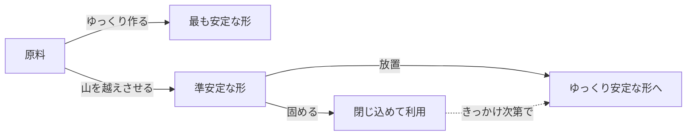

## 概要

同じ原子からできていても、**並び方が違えば別の物質のように振る舞う**。
ダイヤモンドと黒鉛はどちらも炭素だけでできているが、一方は最も硬い透明な宝石、もう一方は柔らかく黒い鉛筆の芯である。
このように、同じ組成が複数の結晶構造をとる現象を**結晶多形**（元素の場合は**同素体**）と呼ぶ。

[メタマテリアル図鑑](metamaterials_catalog.md) が「人が設計した形」で材料の限界を超える話だったのに対し、このノートは**原子そのものの並び方**で性質が変わる話を扱う。

WIIMの視点で特に面白いのは**準安定**という考え方である。
最も安定な状態ではないのに、別の状態へ移るための「山」が高いせいで、事実上いつまでも留まっている状態のこと。
ダイヤモンドはその代表で、常温・常圧では黒鉛のほうが安定だが、変わるのに天文学的な時間がかかる。
そして同じ構図は、宇宙の真空そのものにも当てはまるかもしれない（[6章](#6-wiimとの接点)）。

---

## 1. きっかけ：60年ぶりの「単純立方」の元素結晶（2026）

結晶の並び方のうち、**単純立方**（サイコロの各頂点にだけ原子がある最も素朴な形）は、意外にも元素ではほとんど見られない。
原子が詰まりにくく、すき間が多いため、たいていはもっと密な並び方を選んでしまうからである。
プレスリリースによれば、これまでの報告例は放射性元素**ポロニウム**の低温相に限られていた。

北海道大学・鳥取大学の研究グループは、透過電子顕微鏡の中で**ヨウ化銀に電子線を当てて分解し、銀が生まれる瞬間**を原子レベルで観察した。

- 普通の銀（面心立方）ではなく、**単純立方の銀ナノ粒子**ができた
- それは、ヨウ化銀のうち準安定な結晶形（γ-AgI）からだけ選択的に生まれた。安定な形のヨウ化銀からは普通の銀ができた
- 計算によると、単純立方の銀は単独では不安定で、**ナノサイズ特有の表面や境界面の影響**で保たれている可能性がある
- 普通の銀より反応しやすく、大気圧の100億分の1という高真空中でも酸化が進んだ

「作ってから調べる」のではなく「作られる瞬間を見ながら、普段は出てこない構造を捕まえる」という発想が新しい。

> M. Sakakibara, H. Nada, Y. Kunisada, T. Yamazaki, Y. Kimura, "Electron-Beam-Assisted Formation of Simple-Cubic Silver", *Nano Letters* (2026). DOI: 10.1021/acs.nanolett.6c03635
> （北海道大学プレスリリース「約60年ぶり2例目の単純立方構造の単体結晶を発見」2026-10-21）

---

## 2. 同素体・多形のおもな例

### 元素

| 元素 | おもな形 | 違い・面白さ |
|------|---------|-------------|
| **炭素** | 黒鉛・ダイヤモンド・フラーレン・カーボンナノチューブ・グラフェン・ロンズデーライト | 常温常圧で最も安定なのは黒鉛。ダイヤモンドは準安定だが、変化が遅すぎて「永遠」に見える。ロンズデーライトは隕石衝突の衝撃でできる六方晶のダイヤモンド |
| **鉄** | α鉄・γ鉄・δ鉄・ε鉄 | 温度で並び方が変わる。焼き入れは高温の並び方を急冷で崩しながら閉じ込め、硬い鋼をつくる技術。ε鉄は超高圧の形で、地球の内核の候補 |
| **スズ** | 白色スズ・灰色スズ | 約13℃より低い温度が長く続くと、金属の白色スズがもろい粉状の灰色スズへ変わっていく（スズペスト）。寒冷地でスズ製品が崩れた逸話が多い |
| **リン** | 白リン・赤リン・黒リン | 白リンは空気中で自然発火するほど反応しやすく、赤リンはマッチ箱の側薬に使えるほど穏やか。黒リンは層状で、半導体材料として研究されている |
| **硫黄** | 斜方硫黄・単斜硫黄・ゴム状硫黄 | 溶かして水に注ぐと、ゴムのように伸びる非結晶の硫黄ができる |
| **酸素** | 酸素分子・オゾン・固体酸素の諸相 | 超高圧で固体酸素は赤くなり、さらに圧縮すると金属になり、極低温では超伝導も報告されている |
| **ポロニウム** | α相（単純立方）・β相 | 単純立方の元素結晶の代表例（1章） |
| **銀** | 面心立方・単純立方（ナノ粒子） | 1章の新発見 |

### 化合物・その他

| 物質 | おもな形 | 違い・面白さ |
|------|---------|-------------|
| **氷** | 普通の氷（Ih）ほか20種前後 | 高圧で密な氷が次々に現れる。超高圧・高温では、酸素の骨組みの中を水素がイオンとして流れる**超イオン氷**が実験で確認されており、天王星や海王星の内部に大量にある可能性がある |
| **二酸化ケイ素** | 石英・コース石・スティショフ石など | コース石やスティショフ石は超高圧でしかできないため、地表で見つかれば隕石衝突の証拠になる |
| **炭酸カルシウム** | 方解石・あられ石 | 貝殻や真珠は、生物が準安定なあられ石を選んで作っていることが多い |
| **医薬品** | 同じ薬の複数の結晶形 | 結晶形が違うと溶けやすさ、つまり効き方が変わる。開発途中で新しい安定な形が現れ、元の形が作れなくなる「消えた多形」の事件も実際に起きている |

### 結晶の「外側」

| 状態 | 特徴 |
|------|------|
| **金属ガラス** | 溶けた金属を急冷し、原子が並ぶ前に固めた非結晶の金属。強くてしなやか |
| **準結晶** | 規則正しいのに繰り返しがない並び方。かつては「ありえない」とされ、発見者は2011年にノーベル化学賞を受けた。隕石や、核実験の跡地の岩石からも見つかっている |
| **金属水素** | 水素を極限まで圧縮すると金属になると1930年代から予言されている。木星や土星の内部に存在すると考えられているが、実験室で作れたかどうかはまだ議論が続いている |

---

## 3. 「本来は存在できない構造」を閉じ込める方法

普通にゆっくり作ると、最も安定な並び方が選ばれる。それ以外の並び方を得るには、**山を越えさせてから、戻る前に固める**必要がある。

| 方法 | しくみ | 例 |
|------|-------|----|
| **高圧** | 押しつぶして密な並び方を強制する | 人工ダイヤモンド・高圧氷・ε鉄 |
| **急冷** | 高温の並び方のまま、動けなくなるまで冷やす | 焼き入れ鋼・金属ガラス |
| **衝撃** | 一瞬だけ超高圧・超高温にして、すぐに解放する | ロンズデーライト・スティショフ石（隕石衝突） |
| **ナノサイズ化** | 表面の割合が大きくなり、表面の都合で並び方が決まる | 単純立方の銀（1章） |
| **鋳型** | 下地の結晶の並びに合わせて、上に載る層の並びを決める | 半導体の薄膜成長（エピタキシー） |
| **非平衡な反応** | 電子線などで結合を切り、普段は通らない道筋で原子を集める | 単純立方の銀（1章） |

なお、結晶ができるときは**いきなり最も安定な形になるとは限らず、まず準安定な形を経由しやすい**という経験則がある（オストワルトの段階則）。
不安定な構造は「作れない」のではなく、「一瞬できるが、見る前に消えている」のかもしれない。1章の研究は、その一瞬を見る方法を示したと言える。

---

## 4. 準安定は「時限爆弾」でもある

準安定な状態は、きっかけさえあれば安定な状態へ雪崩のように変わる。

- **過冷却水**：0℃以下でも凍らずにいる水は、衝撃や小さな氷のかけら1つで一気に凍る
- **スズペスト**：灰色スズの小さな種が触れると、そこから変化が広がっていく
- **消えた多形**：新しい安定な結晶形が一度でも現れると、その「種」が工場中に広がり、元の結晶形がどうしても作れなくなることがある
- **プリオン**：正しく折りたたまれたタンパク質が、異常な形のタンパク質に触れると次々と異常な形に変わっていく。結晶ではないが、「形が形を写していく」という同じ構図をもつ

この「触れたものを自分と同じ形に変える種」の極端な形が、カート・ヴォネガットの小説『猫のゆりかご』に登場する**アイス・ナイン**である。常温で安定な氷の一種で、ひとかけら触れるだけで世界中の水が凍りつく、という架空の物質だ。

---

## 5. 越えられない壁

| 夢 | 壁 | 理由 |
|----|----|------|
| **常温常圧の金属水素** | 準安定性が未確認 | 圧力を抜いても金属のまま残るという予想はあるが、そもそも生成自体が実験的に確定していない |
| **どんな構造でも狙って作る** | 寿命 | 準安定な形は、山の高さに応じていつかは崩れる。山が低いと、ナノ秒単位で消えてしまう |
| **アイス・ナイン** | 熱力学 | 普通の水より安定で、しかも常温で固体の氷があるなら、地球の長い歴史のどこかで偶然できて、海はすでに凍っているはずだと考えられる。現実の高圧氷は、圧力を抜けば普通の氷か水に戻る |
| **ナノ構造を大きくする** | 表面の効果が薄まる | 単純立方の銀を安定にしているのが表面の効果なら、粒を大きくするほど支えがなくなり、普通の銀に戻ると考えられる |

---

## 6. WIIMとの接点

| 実在の現象 | 発想の延長先 | WIIM記事 |
|-----------|-------------|---------|
| 準安定（ダイヤモンド・過冷却水） | 宇宙の真空そのものが準安定で、「より安定な真空」へ崩れる可能性 | [wiim_125](../physics/wiim_125.md) 真空崩壊を実験できるか、[wiim_137](../cosmology/wiim_137.md) 膜の外への避難 |
| 種が触れると連鎖的に変わる（スズペスト・プリオン） | 普通の原子核よりストレンジ物質のほうが安定なら、ストレンジ物質の小片が触れた物質を次々と変えていくという仮説 | [wiim_023](../physics/wiim_023.md)、[ストレンジ物質とワープドライブ](wiim_023_strange_matter_warp.md) |
| ナノサイズ・界面による安定化 | 「場所の条件」で本来ありえない状態を保つ | [wiim_124](../physics/wiim_124.md) トポロジカル鋳型（格子が欠陥を安定させる） |

ダイヤモンド・過冷却水・真空崩壊・ストレンジ物質は、どれも「**今いる状態は一番下の谷ではなく、山が高いから留まっているだけかもしれない**」という同じ問いの、スケールの違う版として並べられる。

### 記事化の候補

- **アイス・ナインが存在したら**——熱力学的にありえない理由（5章）を、物理・技術・論理の3観点で論じられる。WIIM粒子で「核になる種」を人工的に作れるか、という方向に広げることもできる
- **常温常圧で金属水素が保てたら**——ロケット燃料・超伝導送電で世界がどう変わるか（入り口と出口に分けられる題材）
- **準安定な物質だけでできた文明**——「触れると崩れる」部品を前提に、どう設計し、どう守るか
