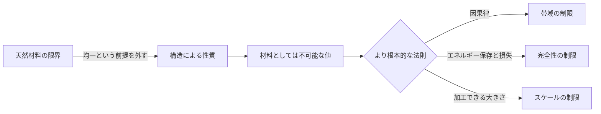

## 概要

**メタマテリアル**とは、性質を「何でできているか」ではなく「どんな形に組んであるか」で決める人工構造のこと。
扱う波（光・音・振動・熱）の波長や、変形のスケールより小さい単位構造（ユニットセル）を規則的に並べることで、天然の材料には見られない振る舞いを引き出す。

WIIMの視点で面白いのは、多くのメタマテリアルが**「材料としては不可能」とされる値を「構造としては」実現している**点にある。
物理法則そのものを破っているわけではなく、「均一な材料」という前提を外すことで限界の外側に出ている——という構図は、WIIMの思考実験で前提条件を変えると不可能性が消える流れとよく似ている。

このノートでは、実在する（実験で確認された）メタマテリアルを分野別に並べ、最後に「それでも越えられない壁」と WIIM 記事との接点を整理する。
人工的な形ではなく、原子の並び方そのものが変わる話は [同じ元素、別の物質——結晶多形](crystal_polymorphs.md) にまとめた。

---

## 1. 力学メタマテリアル——押す・引く・ねじる

| 名称 | 何が起きるか | 面白さ・応用 |
|------|-------------|-------------|
| **オーセティック**（負のポアソン比） | 引っ張ると横に太り、押すと横に縮む | 衝撃吸収・クッション・ステント。普通の均一材料ではポアソン比 −1 を下回れないが、構造としては −1 未満も報告されている（下記コラム） |
| **負の圧縮率** | ある荷重を超えると、引っ張っているのに逆に縮む（座屈の連鎖による一時的な現象） | 「力を加えた方向と逆に動く」部品。安全装置や力の増幅器の発想につながる |
| **ペンタモード** | 押しつぶしには強いが、ずれ（せん断）にはほとんど抵抗しない「水のような固体」 | 音響クローク（音の透明マント）の材料候補。固体なのに流体のように音を通す |
| **押すとねじれる**（キラル構造） | 真上から押すと、本来は起きない回転が生じる | 直線運動を回転に変える機構を、歯車なしで1つのブロックに埋め込める |
| **多安定・エネルギー閉じ込め** | 押すとカチッと別の形に切り替わり、離しても戻らない | 繰り返し使える衝撃吸収材（弾性体なのに、エネルギーを熱にせず形として蓄える） |
| **負の熱膨張** | 温めると縮む（膨張率の違う2素材を組み合わせる） | 温度で寸法が変わらない精密部品。宇宙望遠鏡の構造材など |
| **トポロジカル力学** | 片側の縁だけが柔らかく、反対側は硬い。どちらが柔らかいかは格子の「位相」で決まる | 局所的な欠陥や傷に影響されにくい「形の性質」で硬さを設計できる |
| **力学的計算・記憶** | 押された回数や順番を、内部の形として覚えている | 電源なしで動く「数を数える材料」「記憶する材料」 |

### コラム：オーセティックの最新例（2026）

大阪大学のグループは、ゴムのように大きく変形する柔らかい樹脂で、**生成AIと非線形シミュレーションを組み合わせてオーセティック構造を設計**し、光造形の3Dプリンタで実物を作って圧縮試験を行った。

- 広い変形範囲で、構造としてのポアソン比 −1.0 未満を維持した
- 内部の壁同士がぶつかるタイミングをそろえることで、左右に偏らずきれいに縮む
- 仕組みは「単位セルがそろって回転する → その後、少しずつ接触して硬くなる」という変形の順番の工夫

均一な材料の限界（−1）を、材料ではなく構造の振る舞いとして下回っている好例である。

> Y. Yang, S. Xu, M. Al Ali, K. Yaji, K. Fujita, "Data-driven topology design and experimental validation of hyperelastic auxetic metamaterials", *Materials & Design* 271 (2026) 117247.

---

## 2. 電磁・光学メタマテリアル——光の進み方を書き換える

| 名称 | 何が起きるか | 面白さ・応用 |
|------|-------------|-------------|
| **負の屈折率** | 光や電波が、境界で「普通とは反対側」に曲がる | 1960年代に理論予言され、2000年代初頭にマイクロ波で実証された。メタマテリアル研究の出発点 |
| **完全レンズ（スーパーレンズ）** | 回折限界（波長の約半分）より細かい像を結ぶ | 負の屈折率の平板で、通常は消えてしまう微細な情報（エバネッセント波）を回復させる。実際は損失のため「完全」には遠い |
| **クローキング（透明マント）** | 電磁波を物体の周りに迂回させ、何もないように見せる | 2006年にマイクロ波で2次元の実証。「変換光学」——空間をゆがめた座標を材料の性質に置き換える——という設計法が生まれた |
| **メタサーフェス・メタレンズ** | 厚さが波長以下の薄膜で、光の位相を1点ずつ制御する | 曲面レンズの代わりに平らなレンズ。スマートフォンのカメラや顔認証センサーで実用化が進んでいる |
| **双曲型（ハイパーボリック）** | 方向によって金属のようにも誘電体のようにも振る舞う | 非常に細かい模様の光を遠くまで運べる。近接場の熱放射を大きく増やせる |
| **ε（イプシロン）ゼロ近傍** | 内部で光の位相がほとんど変化しない | 細く曲がった通路でも波がそのまま通り抜ける「トンネル」的な振る舞い |
| **放射冷却** | 大気の窓（8〜13 µm）だけで強く熱を放ち、太陽光はほぼ反射する | 直射日光の下でも外気より冷たくなる。電力不要の冷房（[宇宙空間・真空における放熱技術](space_thermal_radiation.md) も参照） |
| **時間変調メタマテリアル** | 性質を時間的に一斉に切り替えると、波が「時間的に反射」する | 空間の鏡ではなく「時間の境界」で波が跳ね返る現象が、マイクロ波の回路で観測されている |

---

## 3. 音響・振動メタマテリアル——音を曲げる・止める

| 名称 | 何が起きるか | 面白さ・応用 |
|------|-------------|-------------|
| **局所共振型** | 内部の小さな共振体が、特定の周波数だけ強く打ち消す | 波長よりずっと薄い壁で低音を遮る。見かけ上「負の質量」のように振る舞う帯域がある |
| **音響クローク** | 音を物体の周りに迂回させる | ソナーから潜水艦を隠す発想の原型。水中では先述のペンタモード構造が候補 |
| **音響ブラックホール** | 板の端を徐々に薄くしていくと、振動が端に向かって遅くなり、反射しなくなる | 機械の振動吸収。名前は比喩で、重力とは無関係 |
| **一方通行の音** | 片方向にだけ音を通す | 回転する流体や非線形構造で、音のダイオードを作る |
| **トポロジカル音響** | 縁に沿ってだけ伝わり、角を曲がっても散乱しにくい音 | 欠陥に強い音の導波路 |
| **地震メタマテリアル** | 地面に穴や柱を周期的に並べ、表面波（地震の揺れの一部）をそらす | フランスで実際の地盤に穴を並べて実験した例がある。都市を守る「巨大な防振構造」の発想 |
| **水面波クローク** | 浮体の周りの水深や構造を工夫し、波を迂回させる | 防波堤・洋上構造物の保護 |

[wiim_034](../physics/wiim_034.md) の負屈折チャンバーや、[wiim_035](../physics/wiim_035.md) のネゴトン格子は、この音響メタマテリアルを架空の物質へ延長したものと位置づけられる。

---

## 4. 熱・拡散メタマテリアル——熱を「光のように」扱う

| 名称 | 何が起きるか | 面白さ・応用 |
|------|-------------|-------------|
| **熱クローク** | 熱の流れを物体の周りに迂回させ、内部の温度を外から見えなくする | 変換光学の考え方を熱伝導に持ち込んだもの。電子部品の熱保護 |
| **熱集中器** | 周囲の熱流を一点に集める | 熱電発電の効率向上 |
| **熱ダイオード** | 一方向にだけ熱を流しやすい | 温度に応じて自動で切り替わる断熱材 |
| **熱錯覚** | 物体が熱的には別の形・別の物体に見える | 赤外線カメラに対する「偽装」 |

---

## 5. それでも越えられない壁

メタマテリアルは「材料の限界」は超えるが、より根本的な物理法則は超えない。
むしろ、どこで止まるかを見ると、WIIM記事が論じる不可能性と同じ種類の壁が現れる。

| 夢 | 立ちはだかる壁 | 理由 |
|----|---------------|------|
| **全波長で効く透明マント** | 帯域の制限 | 波を迂回させると遠回りした分だけ遅れる。それを取り戻すには光より速い伝わり方が要り、因果律（原因は結果より先）と両立しない。外からエネルギーを注がない受動的な構造では、広い帯域で完全に隠すことはできないとされる |
| **完全レンズ** | 損失 | 現実の材料にはわずかな吸収があり、細かい情報ほど指数的に消えてしまう |
| **可視光での大型クローク** | 加工精度 | 単位構造を波長よりずっと小さく（数十ナノメートル）、しかも大面積に作る必要がある |
| **何でも吸収する薄い壁** | 厚さと帯域の関係 | 低い音を広い帯域で吸収するには、ある程度の厚みが必要という下限が示されている |
| **永久に縮み続ける構造** | 接触と飽和 | オーセティック構造もいずれ壁同士がぶつかって普通の固体に戻る。今回の論文では、この接触を逆に利用して変形を安定させている |

---

## 6. WIIMとの接点

| 実在のメタマテリアル | 発想の延長先 | WIIM記事・用語 |
|---------------------|-------------|---------------|
| 変換光学（空間をゆがめた座標を材料に置き換える） | 逆に「時空そのもの」を材料のように設計する | [wiim_090](../cosmology/wiim_090.md) クロノスフィア時空メタマテリアルシールド、用語「時空メタマテリアル」 |
| 音響メタマテリアル・負屈折 | エキゾチック物質で音を運ぶ・止める | [wiim_034](../physics/wiim_034.md)、[wiim_035](../physics/wiim_035.md) |
| トポロジカル力学・トポロジカル音響 | 位相欠陥を安定させる格子を「鋳型」として使う | [wiim_124](../physics/wiim_124.md) トポロジカル鋳型、用語「トポロン鋳型」 |
| 時間変調メタマテリアル（時間反射） | 時間方向の境界を作る | [wiim_002](../cosmology/wiim_002.md) クロノスフィア |

### 記事化の候補

上の「越えられない壁」は、記事の題材になりうる。

- **「全波長・全方向の完璧な透明マント」が実現したら**——因果律の壁を、WIIMの架空粒子で回避できるか（物理・技術・論理の3観点で論じられる）
- **「ポアソン比が無限に負の材料」**——押せば押すほど全方向に縮み続ける物質は、エネルギー的に何を意味するか
- **「時間反射で信号を過去側に返す」**——時間変調メタマテリアルの延長として、どこで因果律にぶつかるか
