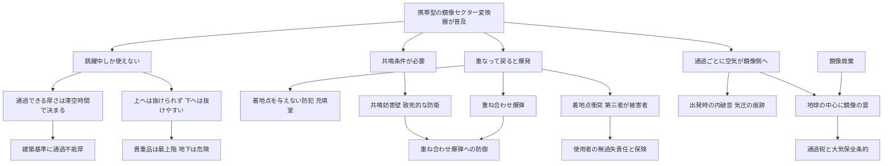

← [補遺・ノート一覧](README.md)

このノートは、[wiim_144](../physics/wiim_144.md)の鏡像セクター変換による壁抜けが、携帯できる装置として普及した世界を想定した世界観メモです。不可能性の根拠はwiim_144（空間の壁）と[wiim_145](../quantum/wiim_145.md)（時間の外への退避）で論じたため、ここでは「物理的な制約がそのまま残ったとき、社会の仕組みがどう組み替わるか」に絞ります。

---

## 1. 前提：wiim_144から引き継ぐ制約

壁抜けは「何でも通れる力」ではなく、制約の多い技術として普及したと仮定します。社会の形を決めるのは、むしろこれらの制約のほうです。

| 物理的な制約 | 社会への翻訳 |
|---|---|
| 変換中は重力しか効かず、床を抜けて落ちる | 跳躍中にしか使えない。滞空時間が通過できる壁の厚さを決める |
| 重なったまま0に戻すと爆発する | 戻る地点に物があってはならない。着地点の安全確認が最重要の作法になる |
| 変換中は暗闇と真空 | 長い通過は人体に負担。訓練と短時間運用が前提 |
| 共鳴条件として周囲の環境を合わせる必要がある | 環境を乱せば変換を妨害できる |
| 変換した空気は鏡像側に四散する | 通過のたびに空気が失われ、圧力の痕跡が残る |

### 補足：着地点の空気交換

wiim_144の設定をそのまま運用すると、問題が一つ見えてきます。0に戻る瞬間、体は**着地点にある空気の分子と重なる**ことになります。人体の体積（約0.07m³）に含まれる空気分子は約2×10²⁴個あり、1個あたり数eVの重なりのエネルギーを仮定すると約100万ジュール、TNT火薬にして約0.25kgに相当すると見積もられます。

そこで普及型の装置では、**戻る瞬間に、着地点の体と同じ形の空間の空気を同時に1へ送り出す**「空気交換」を標準とします。送り出された空気は鏡像側に四散するので、体と重なることはありません。1回の通過で失われる空気は、出発時の泡と着地点の交換分の二つになります。

---

## 2. 建築：壁の価値は「厚さ」と「高さ」に移る

### 通過できる厚さは滞空時間で決まる
変換中に床を抜けないためには、足が床の高さまで落ちる前に0へ戻らなければなりません。つまり**跳躍の滞空時間**が上限になります。

- 約45cmの垂直跳びの滞空時間は約0.6秒
- 歩きながらの跳躍（秒速1〜2m）なら、通過できる壁の厚さは約0.6〜1.2m
- 全力疾走からの跳躍（秒速約8m）でも、約5mが上限

このため建築基準には、**「通過不能厚」**（たとえば6m以上の壁は誰にも抜けられない）という区分が生まれると考えられます。金庫室や刑務所の壁は、強度よりも厚さで設計されるようになります。

### 上へは抜けられず、下へは抜けやすい
変換中は重力しか効かないため、壁抜けは**下り方向にだけ極端に強い**技術になります。

- **天井は抜けられない**: 跳んでも数十cmしか上がれないので、天井のスラブ（床板）を下から抜けることはできません。
- **床は抜けられる**: 変換すれば勝手に落ちるからです。ただし、床スラブの厚さを落ちきる前に0へ戻ると、スラブの中で爆発します。下の階の空間に完全に出てから戻る、正確なタイミング制御が要ります。

その結果、**貴重品は最上階に置き、地下室は最も危険な場所になる**という、現代とは逆の防犯常識が生まれます。上階から侵入されないことは、建物の上空に何があるかで決まります。

---

## 3. 防犯：「着地点を与えない」設計

### 着地点の否定
壁を抜けた侵入者は、壁の向こう側の**何もない空間**でなければ0に戻れません。そこで防犯の基本は、侵入者に着地点を与えないことになります。

- **充填室**: 金庫室の内部を、ゲルや砂のような流動体で満たしておく。抜けた先に空間がないので、侵入者はどこにも戻れない
- **可動障害物**: 室内の物の配置を不規則に動かし、着地点の安全確認をできなくする

### 共鳴妨害壁
変換には、周囲の環境を鏡像側に合わせる共鳴条件が必要です（wiim_144）。壁の内部や周囲で**不規則に揺らぐ磁場**を発生させれば、変換を不完全にできます。ただし、不完全な変換は侵入者の体内に電離した層を作るため、**妨害は致死的な防衛手段**になります。正当防衛の範囲をどう定めるかが法的な争点になると考えられます。

### 痕跡：内破音と重力
壁抜けは静かな技術ではありません。

- **出発時の内破音**: 出発地点では、体と泡の体積ぶんの空気が一瞬で消え、周囲の空気が流れ込んで破裂音を立てます。
- **気圧の痕跡**: 密閉された部屋では、空気交換によるわずかな気圧の変化が記録に残ります。
- **重力だけは隠せない**: 変換中の人も重さは持ち続けるので、精密な重力計（重力勾配計）を壁の近くに置けば、通過中の質量を検知できる可能性があります。光では見えない侵入者を重さで見つけるという意味で、[wiim_138](../cosmology/wiim_138.md)のダークマター観測と同じ構図になります。

---

## 4. 戦争：重ね合わせ爆弾と鏡像廃棄

### 重ね合わせ爆弾
「重なったまま戻すと爆発する」という失敗は、そのまま兵器になります。物体を1に変換して標的の内部へ投げ込み、内部で0に戻すと、物体と標的の原子が重なって爆発します。

- エネルギーは原子1個あたり数eV〜数十eVで、**化学結合と同じ桁**です。1kgの物体で、TNT火薬にして約20kg相当と見積もられます。
- 核兵器ほどではありませんが、**装甲も壁も無意味**になります。標的の内部へ直接届けられるからです。
- 防御側の主な手段は、前節の共鳴妨害です。これは、変換された物体が**標的の内部で戻れなくなる**（不完全な変換で崩れる）ことを狙ったものです。

### 鏡像廃棄と「地球の内側の見えない大気」
戻さずに1のまま捨てれば、物体はこちらの世界から完全に消えます。核廃棄物の究極の処分方法に見えます。しかし捨てられた物体は消えるわけではありません。

- 重力しか効かないため、地球の中心へ向かって落ち、地球を突き抜けて反対側まで行き、また戻ってくる、という往復を約40分周期（地球の密度が一様だと仮定すると約84分）で続けると考えられます。
- 1の物体どうしは互いに衝突するので、捨てられた物体や、通過のたびに四散した空気は、やがて**地球の中心付近に溜まる「鏡像の雲」**になります。
- 地球の質量がわずかに増え、こちらからは重さしか見えません。鏡像側に住人がいるなら、その人々にとっては大量の不法投棄です。

通過1回で失われる空気を約1kg、世界中で1日10億回の通過があると仮定すると、年間の損失は約4×10¹¹kgです。地球大気の総質量（約5×10¹⁸kg）に比べれば千万年単位の時間がかかる量ですが、**ゼロではない**ため、通過税や大気保全条約の根拠になります。

---

## 5. 事故：失敗の類型と保険

| 事故の型 | 原因 | 結果 |
|---|---|---|
| 早期復帰 | 滞空時間の見積もり誤り、装置の誤作動 | 体の一部が壁や床と重なって爆発 |
| 着地点衝突 | 着地点に人や物がいた | 双方が重なって爆発。被害者は壁抜けをしていない第三者 |
| 部分変換 | 共鳴の不一致、装置の劣化 | 体内に電離した層ができる。即死か重い放射線障害に似た症状 |
| 鏡像側衝突 | 鏡像側の同じ場所に物があった | こちらからは原因を確かめられない。wiim_144の「借りた側の代償」 |
| 落下事故 | 復帰に失敗して1のまま | 地球の中心へ落ちる。救出は原理的に不可能に近い |

特に**着地点衝突**の被害者は、壁抜けをしていない一般の人です。壁の向こう側に立っているだけで爆発に巻き込まれうるため、通過前に着地点の安全を確かめる義務と、壁抜け使用者の無過失責任が、保険制度の中心になると考えられます。

**鏡像側衝突**は、こちら側の誰にも過失がない事故です。保険の約款では「不可抗力」として扱われるでしょう。ただし、事故が増えれば「鏡像側の同じ場所に何があるか」を重力で地図にする事業が生まれると考えられます。

---

## 6. 全体像

---

## 関連

- [wiim_144](../physics/wiim_144.md) — 鏡像セクター変換による壁抜け（本ノートの前提技術）
- [wiim_145](../quantum/wiim_145.md) — 時間の外への退避（通過中の暗闇を本人が経験しないようにする試みと、その代償）
- [wiim_138](../cosmology/wiim_138.md) — 膜の裏側の物理（重力でしかつながらない物質を、重さだけで見つける）
