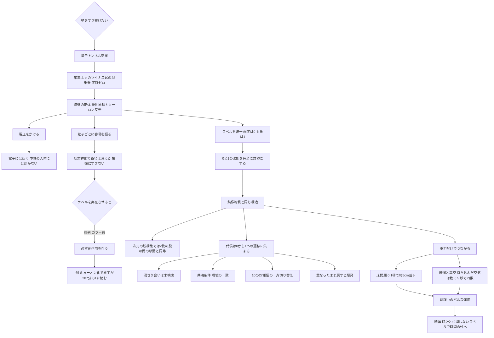

## 1. 概要 (Abstract)

人間の体が壁をすり抜ける確率は、量子力学的にはゼロではない。量子トンネル効果（g097）によって、粒子は越えられないはずのエネルギーの壁を一定の確率で通り抜けるからだ。しかし体全体が厚さ10cmの壁を越える確率を見積もると、**e のマイナス10の38乗乗**程度になる。宇宙の年齢のあいだ毎秒試し続けても、まず起きないと考えられる数字だ。

この壁の正体は何か。手と壁が重なれないのは、主にパウリの排他原理（g060）のためだと考えられる。手の電子と壁の電子は同じ種類のフェルミオン（g064）であり、同じ状態を占められない。無理に重ねれば、電子をより高いエネルギーの状態へ押し上げなければならない。これにクーロン反発が加わったものが、トンネル計算でいう「障壁の高さ」だ。

それなら、**壁の電子と自分の電子を「別の種類の粒子」にしてしまえばよい**のではないか。本記事はこの発想を出発点に、粒子に番号を振る「量子ラベリング」がなぜ数学上の手品にとどまるのかを確かめる。そのうえで、**現実の物質をすべてラベル0、対象の物体をまとめてラベル1とする「ラベルの統一」**が、実在の仮説である鏡像物質（ミラー物質）と同じ構造になることを論じる。

> **前提①:** 標準模型の完全なコピーである「鏡像セクター」が存在し、こちらの物質とは重力でしかほぼ相互作用しない。
> **前提②:** 物体とその周囲を、こちら側（ラベル0）から鏡像側（ラベル1）へ一時的に移し、また戻す装置が作れる。
> **命題:** 「物体を鏡像セクターに移せば壁を通り抜けられるか。そのとき、代償はどこに現れるか？」

本記事は「どうすれば壁を抜けられるか」を扱う入り口記事である。続編として、時計と相関しないラベルを使って時間の外へ退避する方法（第二段階）と、壁抜けが日常化した世界（出口記事）を予定している。

---

## 2. 実現不可能性の根拠 (Infeasibility Rationale)

### 物理的限界

**トンネル確率は質量と粒子数で指数関数的に潰れる。** トンネル確率は、壁の厚さ、通る物体の質量、障壁の高さがそれぞれ大きくなるほど指数関数的に小さくなる。体を約10²⁷個の原子の集まりとし、原子1個あたり約1eVの障壁を仮定すると、体を一つの塊として扱っても、原子を一つずつ扱っても、指数の大きさは10³⁸程度になる。しかも原子が一つずつ通り抜けるなら、向こう側に現れるのは「人体だった原子の集まり」にすぎない。形を保ったまま一斉に通り抜けるには全原子の量子的なまとまりが必要だが、それは環境との相互作用（デコヒーレンス、g173）で瞬時に壊れる。

**電圧では障壁を下げられない。** 強い電場は、電子にとっての障壁を傾けて薄くする。この効果は実際に使われており、電界放出（ファウラー＝ノルドハイム型トンネル）、フラッシュメモリの書き込み、走査型トンネル顕微鏡などがその例だ。しかし効くのは、軽くて電荷を持つ電子だからである。ほぼ電気的に中性の人体には、電場で障壁を傾ける「取っ手」がない。原子1個あたりeV程度の障壁を下げるには、原子内部の電場（約10¹¹V/m）に匹敵する電場が要ると見積もられ、その前に壁も人体も絶縁破壊を起こして電離してしまう。

**粒子1個ずつに番号を振っても、排他は解除されない。** 量子力学の計算では電子に「1番」「2番」と番号を振るが、そのあと波動関数を反対称化（粒子を入れ替えると符号が反転する形に組み直すこと）して、番号の意味を消すのが正式な手順だ。番号は計算用の帳簿にすぎない。同種粒子が区別できないことは、ギブズのパラドックスや光子のホン＝オウ＝マンデル効果などで観測的に確かめられている（[wiim_053](../quantum/wiim_053.md)）。帳簿に書き込むだけで現実が変わるわけではない。

ただし、ラベルが本物になった前例はある。1960年代、アップクォーク3個がすべて同じスピンの向きで詰まったΔ⁺⁺粒子は、排他原理に違反しているように見えた。これを救うために導入された「3種類の隠れたラベル」がカラー荷であり、のちに実験で確かめられ、グルーオンや閉じ込めといった大量の物理的帰結を伴う実在の量子数になった。ここから得られる教訓は次のとおりだ。

- ラベルに**何も結合しない**なら帳簿にすぎず、排他は解除されない
- ラベルに**何かが結合する**なら、質量・相互作用・エネルギーが変わり、副作用が出る

現実にある「ラベル違いの電子」はミューオン（g507）だ。ミューオンと電子のあいだに排他は働かない。しかしミューオンは電子の約207倍重いため、壁の電子をミューオンに置き換えると原子は約207分の1に縮み、壁は高密度の塊に潰れる。しかもミューオンの寿命は約2.2マイクロ秒しかない。**ラベルの代償として、壁が壁でなくなる**わけだ。

### 技術的限界

ラベルを粒子ごとではなく「0か1か」に統一し、0の世界と1の世界の物理法則を完全に同じにすれば、ミューオンのような副作用は消える。これが鏡像物質の仮説で、1960年代に提案され、ダークマター（g056）の候補としても研究されてきた。しかし難しさは消えたのではなく、**0から1へ移す遷移そのもの**に集まる。

- **混ざり合いが見つかっていない**: 中性子が鏡像中性子へ振動して「消える」現象は、複数の研究施設で探索されてきたが、近年の実験でも見つかっていない。両セクターの混ざり合いは、仮にあっても極めて弱いと考えられる。装置はこれを桁違いに増幅しなければならない。
- **共鳴条件**: こうした振動は、両側の環境（たとえば磁場）が一致しないとエネルギーがずれて起きにくくなる。装置は、変換する物体の周囲の環境を「鏡像側の同じ場所の環境」に一致させる必要がある。
- **一斉切り替え**: 人体1つで約10²⁷個の粒子を同時に移す必要がある。一部だけが移ると、原子核が0のまま電子だけが1になる、といった混在が起き、その原子は束縛を失って電離する。10⁻⁶という一見小さな失敗率でも、壊れる結合は10²¹個にのぼる。
- **重なったまま戻すと爆発する**: 壁の中にいる最中にラベルが0へ戻ると、重なった電子が一斉に高いエネルギー状態へ押し上げられる。原子1個あたり数eV〜数十eVを仮定すると、腕1本ぶん（約10²⁵個の原子）で数百万〜数千万ジュール、TNT火薬にして約1kg〜20kgに相当するエネルギーと見積もられる。

### 論理的限界

**完全な対称性と、それを破る装置の矛盾。** 副作用をなくすには、0と1の物理が完全に対称でなければならない。ところが変換装置は、0の物質でできていながら1の側にも作用する。つまり**装置の存在そのものが、頼りにしている対称性を局所的に破る**。装置が強く作用するほど0と1の混ざり合いが大きくなり、変換中の物体は「0でも1でもない状態」を通過する。この中間状態で何が起きるかは、対称性の議論からは何も保証されない。

**次元の側に代償が移るだけである。** 物理には、余剰次元（g255）を「点が数個しかない格子」に置き換えて扱う、次元の脱構築（ディコンストラクション）という手法がある。点が2つの場合、粒子が「どちらの点にいるか」がまさに0/1のラベルになる。ラベルの書き換えは、2枚のブレーン（膜状の宇宙、g523）の間を飛び移ることと数学的に同じだと考えられる。したがってこの壁抜けは「壁をなくした」のではなく、**壁のない隣の世界を一時的に借りた**ことになる。借りた側では次の代償が生じる。

- 変換の瞬間に生じるエネルギーのずれは、鏡像側に放出されるか、鏡像側から借りられる
- 鏡像側の同じ場所に何があるかは、こちら側からは光で見えないため、事前に確かめられない（鏡像物質がダークマターの一部なら、鏡像側の惑星や岩石に重なる危険がゼロとは言えない）

---

## 3. 実験の設定 (Setup)

1. **主体**: 体重70kgの人間1人。
2. **環境**: 地上の建物。厚さ10cmのコンクリート壁で隔てられた2つの部屋。
3. **装置**: 「鏡像セクター変換器」。指定した範囲の物質を、周囲の空気ごと泡状にまとめてラベル1へ移し、指定時間後に0へ戻す。
4. **操作**:
   - 壁の手前で、主体と周囲約1m³の空気をラベル1へ変換する
   - 主体は歩いて（または跳んで）壁を通過する
   - 壁の向こう側に完全に出たことを確認してから、ラベル0へ戻す

**なぜ周囲ごと変換するのか**: 物体だけを移すと、皮膚と空気、足と床の境界でラベルが食い違い、共鳴条件の不一致が最も大きくなる。周囲を含む「泡」としてまとめて移せば、境界を物体から離れた空気中に置ける。境界をまたぐ空気の分子が少数壊れるだけで済むと考えられる。

---

## 4. 考察と予測 (Speculation)

### 予測される結果

**① 壁は「見えたまま」ではなく「見えなくなる」。** ラベル1になった主体にとって、ラベル0の光は相互作用しない。外の世界の光は目に入らず、壁も部屋も見えない。泡の中に持ち込んだ光も、1の側には止めるものがないため、壁を素通りして一瞬で飛び去る。変換中、主体は**ほぼ完全な暗闇**の中にいると予測される。

**② 持ち込んだ空気は保持されない。** 1の空気を閉じ込める1の壁は存在しないため、泡の空気は音速（約340m/s）で四方へ広がる。半径1m程度の泡なら、**数ミリ秒で主体のまわりは真空に近くなる**と考えられる。周囲ごと変換する意味は、変換の瞬間の境界処理にとどまり、長時間の生命維持には役立たない。
- 四散したラベル1の空気は、主体を0へ戻したあとも鏡像側に残る。1回の通過ごとに約1kgの空気がこちらの世界から「消える」ことになる。こちら側の住人には、質量保存がわずかに破れたように見える（[wiim_138](../cosmology/wiim_138.md)の「表から見ると破れる法則」の小さな実例）。

**③ 床問題は確実に起きる。** 0と1をつなぐのは重力だけなので、ラベル1の主体は床に支えられず、地球の中心へ向かって落ち始める。逆に壁だけを1にすると、今度は壁が床を抜けて落ちていく。
- ただし、厚さ10cmの壁を歩いて抜けるのにかかる時間は約0.1秒で、その間の落下は約5cmにとどまる。**通過の瞬間だけ変換するパルス運用**なら成り立つと考えられる。0.1秒の暗闇と真空も、人体が耐えられる範囲だと推測される。
- 床に足を着けたまま変換すると、泡の境界が床を切り取り、床の円盤が一緒に1へ移ってしまう。その円盤は壁の向こうで0へ戻った瞬間に、向こう側の床と重なって爆発する。したがって**変換は跳躍中に行う**のが基本になる。

**④ 失敗の形は「欠損」ではなく「爆発」と「電離」。** 戻すのが早すぎれば体の一部が壁と重なって爆発し、一斉切り替えが不完全なら体内に電離した層ができる。どちらも即死級であり、装置には極めて低い誤り率と、通過完了を確かめる仕組みが求められる。

### 哲学的な問い

- 1の側にいる0.1秒間、主体は何も見えず、何も触れず、重力だけを感じている。そのとき主体は「この世界にいる」と言えるか。重力でしかつながっていない存在は、こちらから見ればダークマターと区別できない。
- 「番号を振る」という帳簿上の操作が、カラー荷のように実在へ変わる境目はどこにあるのか。それは「そのラベルに何かが結合したとき」だとすれば、**物理的な実在とは「相互作用の相手がいること」**なのかもしれない。
- 壁は「なくなった」のではなく、主体が「壁のない世界へ移った」。この区別は、壁の側から見て意味を持つだろうか。

---

## 5. 数式による表現 (Mathematical Notation)

トンネル確率の大まかな形（WKB近似）：

$$P \sim \exp\left(-\frac{2d}{\hbar}\sqrt{2m\,\Delta E}\right)$$

壁の厚さ $d$、通る物体の質量 $m$、障壁の高さ $\Delta E$ がいずれも指数の中に入っている。人体の場合は指数が10³⁸程度になる。$\Delta E$ の正体はパウリの排他原理とクーロン反発による「重なりのエネルギー」だ。鏡像セクター変換は、$d$ や $m$ を小さくするのではなく、**壁と体のあいだの $\Delta E$ を相互作用ごと消す**方法だと言える。

---

## 6. 図解 (Diagrams)

---

## 7. 関連記事 (Related)

- [wiim_053](../quantum/wiim_053.md) — 粒子に個性を持たせることができるか（量子的同一性と標識問題。本記事の「番号は帳簿にすぎない」の詳細）
- [wiim_135](wiim_135.md) — フォノンはヘリウムになれるか（排他原理の有無が分岐点になる例）
- [wiim_138](../cosmology/wiim_138.md) — 膜の裏側の物理（鏡像物質型の模型、裏の物質がダークマターに見える条件）
- [wiim_136](../cosmology/wiim_136.md) — ブレーン宇宙の移動（他の宇宙の空間を借りる移動方式）
- [wiim_060](wiim_060.md) — 逆クロノスフィア（完全な時間停止には無限のエネルギーが要る。続編の出発点）
- [wiim_145](../quantum/wiim_145.md) — 時間の外への退避（時計と相関しないラベル。本記事の第二段階）
- （未作成）壁抜けが日常化した世界——建築・防犯・戦争・事故

**関連用語（用語集）**
- 量子トンネル効果 (g097)
- パウリの排他原理 (g060)
- ボソン／フェルミオン (g064)
- ミューオン (g507)
- デコヒーレンス (g173)
- ダークマター (g056)
- ブレーンワールド (g523)
- 余剰次元 (g255)
