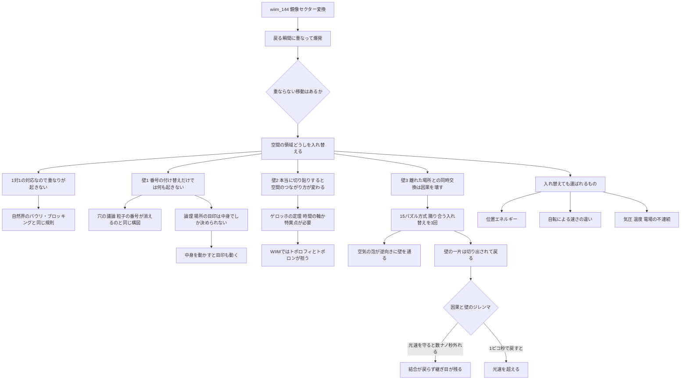

## 1. 概要 (Abstract)

[wiim_144](wiim_144.md)では、物体を重力だけでつながる鏡像セクターへ一時的に移して壁を抜ける方法を論じた。そこで最大の危険となったのは、**0に戻る瞬間に、体が壁や空気と重なって爆発する**ことだった。この爆発の原因は、ぶつかる速さではない。普段なら近づくにつれて少しずつ感じる反発の坂を飛ばして、体を坂の頂上にいきなり置いてしまうことにある。

では、そもそも重なりが起きない移動の方法はないだろうか。本記事が検討するのは、**物体を動かすのではなく、空間の領域どうしを入れ替える**方法である。体のある領域Aと、壁の向こうにある同じ形の空気の領域Cに印を付け、中身ごと入れ替える。Cの空気は同時にAへ移るので、誰も誰とも重ならない。本記事ではこれを「トポロジカルトランスレーション」と呼ぶ。

これは[wiim_097](wiim_097.md)のトポロジカル置換ワープ（空間のつながり方を書き換えて、進行方向を別の地点へつなぐ方式）を、「つなぐ」から「入れ替える」へ進めたものにあたる。

> **前提①:** 空間の領域に印（ラベル）を付け、印の付いた領域どうしの中身を入れ替える操作ができる。WIIMの世界観では、時空のつながり方そのものを決める架空の場トポロフィ（g293）と、その局所的な励起トポロン（g294）がこの操作を担う。
> **前提②:** 入れ替える領域どうしは、同じ形と同じ体積を持つ。
> **命題:** 「空間の入れ替えで、重なりを起こさずに壁の向こうへ移れるか。そのとき、代償はどこに現れるか？」

---

## 2. 実現不可能性の根拠 (Infeasibility Rationale)

### 入れ替えが「重ならない」理由

入れ替え（数学の言葉では置換）は、すべての点が、ちょうど一つの行き先を持つ1対1の対応（全単射）である。行き先にあったものは必ずどこかへ移るので、二つのものが同じ場所に来ることは原理的に起きない。

自然界の粒子生成も同じ規則に従っている。量子場の理論では、電子のようなフェルミオンをすでに埋まった状態に作る確率はゼロであり、これをパウリ・ブロッキングと呼ぶ。LHCのような加速器で新しい粒子が大量に生まれても爆発が起きないのは、粒子が空いている状態にしか生まれないからだ。入れ替えは、この規則を**操作の形そのものによって自動的に守る**、数少ない移動方法だと言える。

wiim_144で問題になった、重なりによる爆発、着地点の空気交換、鏡像セクターでの暗闇・真空・落下は、この方法ではいずれも生じない。

### 物理的限界

**壁1：番号を振り直すだけでは、何も起きない。** 空間の点に「A」「C」と印を付けて入れ替える、と言うのは簡単だ。しかし一般相対性理論（g108）では、空間の点に振った番号（座標）には物理的な意味がない。座標を滑らかに付け替える変換（微分同相変換）をしても、観測できる物理は何も変わらない。アインシュタインは「穴の議論」と呼ばれる思考実験で、当初はこれを理論の欠陥と考えた。のちに「時空の点は、そこにある物や場との関係を離れて個性を持たない」と理解し直したことが、一般相対性理論を完成させる鍵になった。

これは、粒子の番号が反対称化で消えてしまう問題（[wiim_053](../quantum/wiim_053.md)、wiim_144）と同じ構図である。粒子に振った番号が帳簿にすぎなかったように、空間に振った番号も帳簿にすぎない。

**壁2：本当に入れ替えるなら、空間のつながり方が変わる。** 入れ替えを物理的な出来事にするには、番号の付け替えではなく、領域を切り取って別の場所に貼り直す必要がある。これは滑らかな変換ではない。瞬間的な入れ替えは、AとCを結ぶ2組のワームホール（g036）が一瞬だけ開いて閉じることに等しく、その途中で空間のつながり方（トポロジー）が変わる。

ゲロッホの定理（と、それを拡張したティプラーらの結果）によれば、一定の条件のもとで、古典的な時空でトポロジーを変えるには、閉じた時間的曲線（g484、過去へ戻る時間の輪）か特異点（g043）が必要になる。これはwiim_097が突き当たったのと同じ壁である。トポロフィは、この壁を越える架空の場として設定されている。

**壁3：離れた場所との同時の入れ替えは、因果を壊す。** AとCが離れているとき、「同時に入れ替える」の「同時」は、相対性理論では観測者によって異なる。ある観測者にとって同時の入れ替えは、別の観測者には「Cに先に現れてからAが消える」、つまり過去への移動に見えうる。[wiim_145](../quantum/wiim_145.md)で検討した「外の世界でも時間が経たない移動」と同じ、因果のパラドックスに入る。

### 技術的限界

**15パズル方式による局所化。** 壁3を避ける方法として、離れた領域を一度に入れ替えるのではなく、**隣り合う領域どうしの入れ替えを順番に繰り返す**方法が考えられる。数学では、どんな置換も「隣り合う二つの入れ替え（隣接互換）」の積に分解できることが知られている。15パズルで駒を一つずつ滑らせて並べ替えるのと同じ発想だ。1回の入れ替えに、その距離を光が進む時間以上をかけるなら、移動の速さは自然に光速以下に収まる。

壁の手前の領域A（体）、壁を含む領域B、壁の向こうの領域C（空気）を考えると、次の3回の隣接入れ替えで、AとCの入れ替えが実現する。

1. AとBを入れ替える：体が壁の位置へ、壁の一片がAへ移る
2. BとCを入れ替える：体が壁の向こうへ、Cの空気が壁の位置へ移る
3. AとBを入れ替える：壁の一片が元の位置へ戻り、空気がAへ移る

最終的に、体はCへ、空気はAへ移り、壁は元どおりになる。途中で、**人の形をした空気の泡が、体とは逆向きに壁を通り抜けた**ことになる。

**壁の切れ目が抱える矛盾。** 手順1で、壁の一片は周囲の壁から切り出され、手順3で戻される。切り口の化学結合は一度切られ、戻されたときに結び直さなければならない。結び直すには、原子の位置を約0.01ナノメートルの精度で元に戻し、切り口の原子が動き出す前、つまり原子の振動の時間（約1ピコ秒）以内に戻す必要がある。

ところが、局所化の条件から、1回の入れ替えには、その距離（体の大きさ程度、約0.5m）を光が進む時間、**約1.7ナノ秒**以上をかけなければならない。手順1から手順3までの間に、壁の一片は少なくとも数ナノ秒外れていることになり、原子の振動の時間より千倍以上長い。その間に切り口の原子は並び直してしまい、戻しても完全には結び直せない。**因果を守るほど壁は傷つき、壁を守るほど因果が危うくなる**というジレンマがある。通過のたびに、壁には髪の毛ほどの継ぎ目が残ると予測される。

**入れ替えても変わらないもの。** 入れ替えは中身の位置を変えるだけで、中身が持っていたものはそのまま運ぶ。

- **位置エネルギー**: 高さの違う場所との入れ替えでは、高さの差に応じたエネルギーの出入りが生じる（第5節）。
- **運動の速さ**: 地球の自転の速さは緯度によって違う。たとえば東京と札幌では地表の速さが秒速約40m異なるため、そのまま入れ替えると、到着した人は地面に対して時速100km以上で動いていることになる。長距離の入れ替えには減速の仕組みが別に要る。
- **気圧・温度・電場**: 入れ替えた境界では、気圧や温度、電場がつながらずに不連続になる。冬の屋外との入れ替えでは冷気が一気に流れ込み、帯電した物の近くでは境界から電磁波が出ると考えられる。

### 論理的限界

**「どこにあったか」を誰が覚えているのか。** 壁1と壁2から、入れ替えには次のジレンマがある。空間の点そのものには個性がないので、「領域A」を指定するには、そこにある物質や場（壁、床、空気）を目印にするしかない。しかし入れ替えの途中では、その目印自体が動いている。手順1のあと、領域Bには体が、領域Aには壁の一片がある。このとき「領域B」とは、壁があった場所のことか、壁の一片が今ある場所のことか。**目印を中身で決めるなら、中身を動かした瞬間に目印も動く**。入れ替えを正しく終えるには、中身とは独立した外部の基準（装置の座標系）が必要になる。だが壁1で見たとおり、物理的な意味を持つ外部の座標系は存在しない。装置は、自分自身を基準とする座標の上でしか入れ替えを定義できず、その装置の位置もまた入れ替えの影響を受けうる。

---

## 3. 実験の設定 (Setup)

1. **主体**: 体重70kgの人間1人。足が床に触れていると境界が床を切ってしまうため、跳躍中に操作する。
2. **環境**: 厚さ10cmのコンクリート壁で隔てられた、同じ高さの2つの部屋。気圧と温度は同じ。
3. **装置**: 「トポロジカルトランスレーター」。指定した同形の3領域（体、壁を含む領域、壁の向こうの空気）について、隣接入れ替えを順に3回行う。
4. **操作**:
   - 体を余裕をもって囲む、人の形の領域Aを指定する（境界は空気中に置く）
   - 壁を含む同形の領域Bと、壁の向こうの同形の空気の領域Cを指定する
   - 手順1〜3を、それぞれ光速の制約を満たす最短時間で実行する

---

## 4. 考察と予測 (Speculation)

### 予測される結果

**① 本人は何も体験しない。** 鏡像セクター変換と違い、主体はどの時点でも普通の物質のままであり、暗闇も真空も落下もない。体験としては、跳んだ瞬間に壁の向こうにいる、というものになると考えられる。

**② 出発点には空気が、壁には継ぎ目が残る。** 出発点のAには、Cにあった空気がそのまま移るので、内破音も気圧の変化も生じない。一方、壁には切り出しと戻しによる継ぎ目が残る。何度も通過された壁は、人の形をした継ぎ目が重なって弱くなる、「通過疲労」を起こすと予測される。

**③ 継ぎ目を避けるには壁を動かさない設計が要る。** 継ぎ目を残さないためには、壁の一片を動かさずに済む入れ替えの手順を探すことになる。たとえば、壁の外側を回り込むように隣接入れ替えを並べれば、壁に触れずにAとCを入れ替えられる。ただし、手順の数が増えるぶん時間がかかり、途中の領域にいる人や物をすべて一時的に動かすことになる。

**④ 鏡像セクター変換との比較。**

| | 鏡像セクター変換（wiim_144） | トポロジカルトランスレーション（本記事） |
|---|---|---|
| 重なりによる爆発 | 戻るタイミングを誤ると起きる | 原理的に起きない |
| 本人の体験 | 約0.1秒の暗闇・真空・落下 | なし |
| 壁への影響 | なし | 切り出しと戻しによる継ぎ目 |
| 代償の行き先 | 鏡像側との遷移、装置が破る対称性 | 空間のつながり方の変化（ゲロッホの定理）、座標の基準 |
| 移動距離 | 壁の厚さ程度（滞空時間で制限） | 原理的には制限なし（減速や環境差の処理が別に要る） |

### 哲学的な問い

- 空間の点に個性がないなら、「同じ場所に戻ってきた」とはどういう意味か。私たちが「場所」と呼んでいるのは、そこにある物との関係にすぎないのかもしれない。
- 壁は元に戻ったが、継ぎ目が残った。原子がすべて元の位置に戻っていれば、それは「同じ壁」か。結合が一度切れて結び直された壁は、修理された壁と何が違うのか。
- 本人は何も体験せず、気づけば壁の向こうにいる。量子テレポーテーション（g141）のように情報を送って作り直すのとは違い、ここでは中身そのものが運ばれている。それでも、途中の自分を誰も観測できないとき、移動したのは「自分」だと言い切れるだろうか。

---

## 5. 数式による表現 (Mathematical Notation)

高さの違う場所との入れ替えで出入りするエネルギー：

$$E = m g \Delta h$$

$m$ は運ぶ物の質量、$g$ は重力加速度、$\Delta h$ は高さの差である。たとえば体重70kgの人を1階上（約3m）の空気と入れ替えると、約2キロジュールが必要になる。逆に下の階と入れ替えると、同じだけのエネルギーが余り、装置が受け止めなければならない。入れ替えは「重なり」の問題を消すが、エネルギー保存の帳尻まで消すわけではない。

---

## 6. 図解 (Diagrams)

---

## 7. 関連記事 (Related)

- [wiim_097](wiim_097.md) — トポロジカル置換ワープ（空間のつながり方を書き換える前作。ゲロッホの定理の壁）
- [wiim_144](wiim_144.md) — 鏡像セクター変換による壁抜け（本記事が別解を示す問題の出発点）
- [wiim_145](../quantum/wiim_145.md) — 時間の外への退避（時間ゼロの移動と因果のパラドックス）
- [wiim_053](../quantum/wiim_053.md) — 粒子に個性を持たせることができるか（番号が帳簿にすぎないという構図）
- [wiim_089](../cosmology/wiim_089.md) — ブラックホール潜入とワームホール開通（空間のつながり方の書き換え）
- [壁抜けが日常化した世界](../notes/wiim_144_wall_passing_society.md) — 建築・防犯・戦争・事故（鏡像セクター方式の社会設定）
- （未作成）入れ替えが日常化した世界——継ぎ目だらけの都市と「場所」の所有権

**関連用語（用語集）**
- トポロフィ (g293)
- トポロン (g294)
- パウリの排他原理 (g060)
- 相対性理論 (g108)
- ワームホール (g036)
- 閉じた時間的曲線 (g484)
- 特異点 (g043)
- 量子テレポーテーション (g141)
