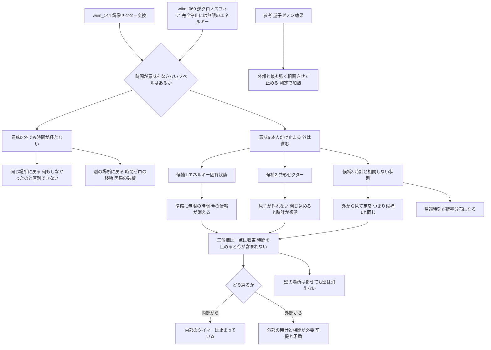

## 1. 概要 (Abstract)

[wiim_144](../physics/wiim_144.md)では、現実の物質をラベル0、対象の物体をまとめてラベル1とし、物体を重力だけでつながる鏡像セクターへ一時的に移すことで壁を抜ける方法を論じた。そこで残った問題は、変換中の約0.1秒のあいだ、主体が暗闇と真空にさらされることだった。

本記事はその第二段階を扱う。0と1の違いが「空間のどちらの膜にいるか」だったように、**時間が存在しない、あるいは意味をなさないラベル**を見つけられないか。そこへ移って戻れば、本人にとっては何も経たずに済むのではないか。

時間を止める試みとしては、すでに[wiim_060](../physics/wiim_060.md)の逆クロノスフィアがある。重力による時間の遅れ（時間膨張、g010）で内部の時間を遅くする方法だが、完全に止めるには無限のエネルギーが要るという壁に突き当たった。本記事の問いは、**その壁を「ラベル」で回り道できるか**である。

> **前提①:** wiim_144の鏡像セクター変換と同様に、物体を別のラベルへ移し、また戻す装置が作れる。
> **前提②:** 移る先として、時間の流れが意味を持たない状態を選べる。
> **命題:** 「時間が意味を持たないラベルは存在するか。そこへ退避した物体は、何も経ずに戻ってこられるか？」

---

## 2. 実現不可能性の根拠 (Infeasibility Rationale)

まず、「時間が経過しない」には二つの意味があることを区別しておく。

| | (a) 本人にとって時間が止まる | (b) 外の世界でも時間が経たない |
|---|---|---|
| 状態 | 外では時間が進み、本人だけが止まる（ステイシス、冷凍睡眠の極限） | 出発した瞬間に戻ってくる |
| 物理的な扱い | 極端な時間の遅れの延長として、整合性を保てる | 下記の論理的限界を参照 |

本記事では主に(a)を扱い、(b)は論理的限界の節で検討する。

### 物理的限界

「時間が意味を持たない状態」の候補は、実在の物理の中に少なくとも三つ見つかる。ところが、どれにも同じ形の壁がある。

**候補1：エネルギー固有状態（定常状態）**
量子力学では、エネルギーがただ一つの値に定まった状態は、波動関数の位相が回るだけで、観測できる量が一切変化しない。原子の基底状態が何十億年たっても同じであるのはこのためだ。時間が意味をなさない状態そのものだと言える。

しかし、二つの壁がある。

- **準備に無限の時間がかかる**: エネルギーと時間の不確定性関係（g311）により、エネルギーのばらつきを小さくするほど、準備や測定に長い時間がかかる。完全に一つの値に定めるには無限の時間が要る。**時間を止めた状態を作るのに、無限の時間がかかる**のである。
- **「今の自分」の情報が消える**: 特定の形をして特定の場所にいる物体は、多数のエネルギー固有状態の重ね合わせとしてしか表せない。「今どんな形か」という情報は、固有状態どうしの相対的な位相に書かれている。一つの固有状態に落とし込むと、その情報は失われる。止まるのは「自分」ではなく、**「いつの自分でもない状態」**だ。

巨視的な物体のエネルギー準位の間隔は、粒子数に対して指数関数的に狭くなる。人体の場合、一つの準位を選び出すのに要する時間は宇宙の年齢を桁違いに超えると考えられる。

**候補2：スケールを持たない世界（共形セクター）**
質量を持たない粒子だけでできた世界には、長さや時間の基準がない。光子には固有時間（g174）が流れない、という事実をセクター全体に拡張したものだ。時計もものさしもないので、そこでは「何秒経ったか」が意味を持たない。

しかし、ものさしがないということは、**原子も分子も作れない**ということでもある。原子の大きさを決めているのは電子の質量だからだ。人体をこのセクターへ移すと、構造そのものが保てない。残せるのは、体の構造を記した「情報」だけになる。さらに、その情報を質量のない放射として閉じ込めておこうとすると、閉じ込める箱の大きさが長さの基準になり、光がその箱を往復する時間が**時計として復活してしまう**。

**候補3：時計と相関しない状態（ペイジ＝ウッターズ機構）**
量子重力の基本方程式の一つであるホイーラー＝ドウィット方程式では、宇宙全体の状態に時間の変数が現れない（量子重力における「時間の問題」）。これに対してペイジとウッターズは、時間とは「時計の役をする系」と「それ以外の系」との**相関**として現れるものだ、と提案した。時計の針が3時を指しているとき、残りの系がどんな状態にあるか、という条件付きの関係が、私たちの経験する時間の流れになる。

これを使えば、**私たちの時計と一切相関しないラベル**へ移った物体については、「こちらの時刻で何時の状態か」がそもそも定義されない。

ただし、ここにも同じ壁が現れる。外部の時計と相関しない状態とは、時計の針がどこを指していても同じ状態、つまり**外部から見て定常な状態**のことであり、候補1のエネルギー固有状態と本質的に同じものになる。

**三つの候補は一点に収束する。** 時間を意味のないものにするには、「今」の情報を消すか（候補1・3）、時計を作る能力ごと構造を捨てるか（候補2）しかない。止めたいのは「今の自分」なのに、時間が止まった状態には「今」が含まれない。

### 技術的限界

- **「今」の情報の退避**: 候補1・3を使うなら、固有状態に落とす前に、相対位相として書かれた「今の自分」の情報を、別の場所に保存しておかなければならない。しかし量子状態はクローン禁止定理（g487）によりコピーできない。保存は「移動」になり、保存先の媒体は時間の中にあり続ける。つまり**時間を止めたのは本人ではなく、保存媒体に時間を押し付けただけ**になる。
- **量子ゼノン効果による近似**: 実験的に時間の進みを抑える現実的な方法として、量子ゼノン効果（g098）がある。系を頻繁に測定すると、状態の変化が抑えられる現象だ。しかし、止まるのは測定した量だけである。人体の全自由度を、最も速い変化（原子核の内部で約10⁻²²秒、電子で約10⁻¹⁶秒）より短い間隔で測り続ける必要があり、その測定がもたらす擾乱と発熱は、体を止める前に焼いてしまうと考えられる。さらにゼノン効果は、外部の測定装置と**最も強く相関させる**ことで時間を止める方法であり、候補3とは正反対の発想だ。
- **共形セクターでの再構成**: 候補2を使う場合、体を情報に分解し、戻すときに再構成する。これは量子テレポーテーション（g141）と同じ構造をもち、戻ってきた主体が元の本人かという同一性の問題を避けられない（[wiim_120](../biology/wiim_120.md)）。

### 論理的限界

**(b)は、空虚か因果の破綻かのどちらかになる。** 外の世界でも時間が経たないまま戻ってくる場合を考える。
- 出発地点と同じ場所に戻るなら、外から見れば何も起きていない。内部でも時間が経っていないなら、**その退避は「しなかった」ことと区別できない**。
- 別の場所に戻るなら、それは空間を時間ゼロで移動したことになる。相対性理論（g108）では、ある観測者にとって時間ゼロの移動は、別の観測者には過去への移動に見え、因果のパラドックスを生む（[wiim_118](../cosmology/wiim_118.md)）。wiim_144の壁抜けと組み合わせて「壁を時間ゼロで抜ける」と、この問題が生じる。

**冷凍庫の中からは扉を開けられない。** (a)の場合でも、戻るきっかけが必要だ。内部で時間が完全に止まっているなら、内部のタイマーは動かず、内部から戻ることはできない。外部から戻すなら、装置は外部の時計と相関していなければならず、「時計と一切相関しない」という前提と矛盾する。**完全な退避と、確実な帰還は両立しない**。

---

## 3. 実験の設定 (Setup)

人間を使う前に、次の対象で検証する。

1. **主体**: 機械式の時計1個と、密閉した細胞培養試料1つ。
2. **環境**: 外部の基準時計と、変換装置を備えた実験室。
3. **装置**: 候補1〜3のいずれかのラベルへ対象を移し、外部時間で1時間後に戻す「時間外退避装置」。比較のため、量子ゼノン効果で凍結する装置も用意する。
4. **操作**:
   - 対象を退避させ、外部時間で1時間後に戻す
   - 主体の時計の進みと、細胞の分裂の進み具合を、外部の基準時計と比較する

---

## 4. 考察と予測 (Speculation)

### 予測される結果

| 方式 | 主体の時計 | 戻る時刻 | 戻ってきたもの |
|---|---|---|---|
| 候補1 エネルギー固有状態 | 進まない | 指定どおり | 時計の「針の位置」が失われ、どの時刻も指していない状態。保存した情報から復元が必要 |
| 候補2 共形セクター | 定義できない | 指定どおり | 構造は一度失われ、情報から再構成された時計 |
| 候補3 時計と無相関 | 何時間進んだか確率的 | 確率分布 | 経過時間が定まらない時計 |
| 参考 量子ゼノン効果 | ほぼ進まない（測定した量のみ） | 指定どおり | 測定の擾乱で加熱・損傷した時計 |

**候補3で起きる「帰還時刻のばらつき事故」。** 時計と相関しないラベルから戻るとき、主体はこちらの時計と再び相関を結ぶ。しかし、退避中のどの状態をこちらのどの時刻に対応させるかは、退避の前後の情報からは決まらない。その結果、**戻ってきた主体が内部で何時間を過ごしたか**と、**こちらの何時に現れるか**が、どちらも確率的にばらつくと予測される。「1時間後に戻るはずが、本人の体感では3日経っていた」「予定より早く、まだ出発前の自分がいる時刻に現れかけた」——後者は(b)の因果の問題に直結するので、装置は「出発時刻より前には戻らない」という制約を外部から課す必要があると考えられる。

**wiim_144への応用。** 当初の目的だった「壁抜け中の0.1秒の暗闇と真空を、本人が経験しないようにする」ことについては、どの候補も割に合わないと考えられる。0.1秒を体験しないために、無限の準備時間（候補1）、体の分解（候補2）、帰還時刻のばらつき（候補3）を受け入れることになるからだ。実用上は、0.1秒程度なら量子ゼノン効果による部分的な凍結か、単に息を止めて目を閉じるほうが合理的だと示唆される。

**逆クロノスフィアとの比較。** wiim_060では、時間を止める代償は「無限のエネルギー」として現れた。本記事では、それが「無限の準備時間」（候補1）、「構造の喪失」（候補2）、「帰還時刻の不確定」（候補3）に姿を変えた。ラベルによる回り道は、**壁の場所を移すことはできても、壁そのものを消すことはできない**と考えられる。

### 哲学的な問い

- 「今」の情報を持たない状態の自分は、自分と呼べるか。時間が止まった状態に「自分」が含まれないなら、時間を止めるとは、自分を一時的に消して、あとで書き戻すことと同じではないか。
- 時間が「時計との相関」にすぎないなら、私たちが「時間が流れている」と感じているのは、世界のほかの部分と相関し続けているから、と言えるかもしれない。完全に孤立した存在にとって、時間は存在するだろうか。
- 戻ってくる時刻を自分で決められない退避は、「時間の外」への避難と言えるのか。それとも、時間の中のどこかへの、行き先不明の移動にすぎないのか。

---

## 5. 数式による表現 (Mathematical Notation)

エネルギーと時間の不確定性関係：

$$\Delta E \cdot \Delta t \gtrsim \frac{\hbar}{2}$$

状態の変化が起きないエネルギー固有状態とは、エネルギーのばらつき $\Delta E$ がゼロの状態である。この関係式から、そのような状態を準備するのに要する時間 $\Delta t$ は無限大になる。逆に言えば、何かが「変化する」ためには、エネルギーにばらつきがなければならない。

なお、量子力学では時間は位置や運動量のような観測量ではないため、この関係は位置と運動量の不確定性関係ほど厳密なものではない。正確には「状態が目に見えて変化するまでの最短時間は、エネルギーのばらつきに反比例する」（マンデルスタム＝タムの関係）という意味で成り立つ。準備時間の見積もりは、エネルギーを測って選り分けるという標準的な手続きを想定したものと考えられる。時間の流れとは、エネルギーのばらつきが外に現れたものだとも解釈できる。

---

## 6. 図解 (Diagrams)

---

## 7. 関連記事 (Related)

- [wiim_144](../physics/wiim_144.md) — 鏡像セクター変換による壁抜け（本記事の第一段階）
- [wiim_060](../physics/wiim_060.md) — 逆クロノスフィア（重力による時間の遅れで内部の時間を止める試み）
- [wiim_002](../cosmology/wiim_002.md) — クロノスフィア（内部の時間を速める装置）
- [wiim_053](wiim_053.md) — 粒子に個性を持たせることができるか（ラベルと量子的同一性）
- [wiim_118](../cosmology/wiim_118.md) — 光速突破は時空を「破断」させるか（時間ゼロの移動と因果）
- [wiim_108](../physics/wiim_108.md) — カオスの悪魔を出し抜く五つの抜け道（量子ゼノン効果の利用）
- [wiim_120](../biology/wiim_120.md) — 菌糸への回帰（分解と再構成による同一性の問題）
- （未作成）壁抜けが日常化した世界——建築・防犯・戦争・事故（出口記事）

**関連用語（用語集）**
- 量子ゼノン効果 (g098)
- 不確定性原理 (g311)
- 固有時間 (g174)
- 時間膨張 (g010)
- 相対性理論 (g108)
- 量子テレポーテーション (g141)
- クローン禁止定理 (g487)
- デコヒーレンス (g173)
