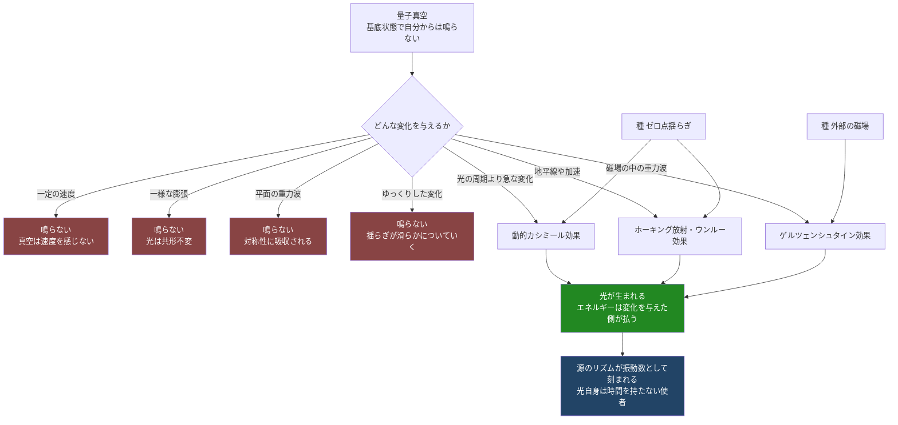

## 1. 概要 (Abstract)

[wiim_146](../cosmology/wiim_146.md) では、光は空間を通り抜けていく「物」ではなく、空間に広がる場の揺れ——いわば「空間の音」——であり、光子はその揺れの最小単位だという描像にたどり着いた。本記事はその出口にあたる。

光が空間の音なら、空間を叩けば光が鳴るはずだ。では、何もない宇宙空間から光を生み出すことはできるのか。できるとすれば、どんな「叩き方」なら鳴るのか。

ここで奇妙な対照が浮かび上がる。光は固有時間（その物体自身の時計の進み）を持たない。それなのに、光を生むのはいつも「時間による変化」——電荷の速度が変わる、境界が揺れる、場が転がり落ちる——である。

> **前提:** 光を「空間の音」とみなし、何もない真空に変化を与えることで光を生み出すことを考える。
> **命題:** 「何もない真空から光を生むことはできるか？　できるなら、光を生むのはどんな変化か？　そして時間を持たない光が、なぜ時間の変化からしか生まれないのか？」

---

## 2. 実現不可能性の根拠 (Infeasibility Rationale)

### 物理的限界

**真空は自分からは鳴らない。** 量子論の真空は空っぽではなく、電磁場はゼロの周りで絶えず揺らいでいる（ゼロ点揺らぎ）。だがこれはエネルギーが最も低い状態（基底状態）であり、これ以上エネルギーを下げられない。何も起きていない真空が自発的に光を出せば、それはエネルギーをどこからともなく取り出す永久機関になる。量子真空の勾配からエネルギーを取り出す試みが同じ壁に突き当たることは [wiim_103](../physics/wiim_103.md) で論じた。

**光を鳴らすエネルギーは、叩いた側が払う。** 後述するように、真空に急な変化を与えれば光は生まれる。しかしそのエネルギーは、鏡を揺らす装置、ブラックホールの質量、加速するエンジン、電場の源といった「変化を与えた側」から支払われる。真空はエネルギーの源ではなく、与えられたエネルギーを光に変える**変換器**として働くにすぎない。

### 技術的限界

真空から目に見える量の光を取り出すには、極端な条件が要る。

- **動的カシミール効果:** 鏡（境界）を、光の振動の周期より速く、光速のかなりの割合の速さで揺らす必要がある。物質の鏡では到底不可能で、観測された例は、超伝導回路の中で電気的に「鏡の位置」を変える工夫によるものに限られる。生まれる光子もごくわずかである。
- **シュウィンガー効果:** 真空から電子と陽電子の対を叩き出すには、およそ 10¹⁸ V/m という電場が必要とされる。最強のレーザーでもまだ届いていない。
- **重力波から光への変換:** 磁場の中で重力波が光に変わる効果（ゲルツェンシュタイン効果）は理論的に予言されているが、重力が桁違いに弱いため、変換される割合は実験室の最強の磁石でも極めて小さく、未観測である。

### 論理的限界

「何もないところから光を生む」という表現自体が成り立たない。光を生むには、どの場合にも次の二つが残る。

1. **変化を与える側**——鏡、地平線、加速する観測者、電場、重力波。
2. **震えの種**——外からかけた磁場か、真空そのもののゼロ点揺らぎ。

「何もない」と言うためにこの二つを取り除けば、光は生まれない。逆に光が生まれたなら、そこには必ず何かがあった。「無から光が生まれた」という観測は、原理的に「まだ特定されていない何かがあった」と区別できないと考えられる。

---

## 3. 実験の設定 (Setup)

1. **環境:** 完全な真空。物質も、外からかけた電磁場もない空間を用意する。
2. **観測対象:** 真空中に現れる光子の数と振動数。
3. **操作①（一定の速度）:** 鏡を一定の速さで動かす。
4. **操作②（ゆっくりした変化）:** 鏡を、光の周期よりずっと長い時間をかけてゆっくり往復させる。
5. **操作③（急な変化）:** 鏡を光の周期より速く揺らす。
6. **操作④（一様な引き伸ばし）:** 空間全体を一様に膨張させる。
7. **操作⑤（地平線と加速）:** 地平線を作る、あるいは観測者を加速させる。
8. **操作⑥（重力波）:** 真空に平面の重力波を一本通す。次に、強い磁場をかけた領域に通す。
9. **比較対象:** 媒質（水）中で荷電粒子を一定の速さで走らせる。

---

## 4. 考察と予測 (Speculation)

### 一定の速度では鳴らない

一定の速さで動く電荷は光を出さない。電荷が光を出すのは、速度が変わるとき——加速する、曲がる、止まる——だけである。電波のアンテナも、X線管の制動放射も、加速器のシンクロトロン光も、この「速度の変化」で光っている。

真空についても同じことが言える。一定の速さで動く鏡は、真空から光を生まない。真空はどの速度で見ても同じに見える（ローレンツ不変）ため、一定の速度は真空にとって「何も起きていない」のと区別できないからだ。[wiim_146](../cosmology/wiim_146.md) の言葉で言えば、空間には静止の基準がなく、空間は一定の速度を感じられない。

唯一の例外は**媒質があるとき**である。水中の荷電粒子が「水中の光速」を超えると、一定の速度のままでも光が出る（チェレンコフ放射）。水という静止の基準があるため、媒質に対する速度が意味を持つ。音の衝撃波と同じ構造だ。

### 急な変化でなければ鳴らない

鏡をゆっくり動かすと、真空の揺らぎはその変化に滑らかについていき、光子は生まれない。光が生まれるのは、変化が**光の振動の周期より速い**ときに限られる。変化が急であるほど、生まれる光の振動数は高くなる。光を生むのは「どれだけ変わるか」より「どれだけ急に変わるか」だと考えられる。

鏡を急に揺らすと光子の対が生まれる現象が**動的カシミール効果**である。「仮想光子が実在の光子に変わる」と説明されることも多いが、これは比喩的表現であり、正確には境界が動くことで真空の電磁モードが組み替わり、その結果として光子が現れる。2011年に超伝導回路で観測された。

圧力の急変が光を生む例もある。水中の小さな泡に強い音波を当てると、泡が急激に潰れる瞬間にピコ秒程度の閃光が出る（**ソノルミネッセンス**）。物理学者シュウィンガーはこれを動的カシミール効果ではないかと提案したが、現在では、圧縮で数千度以上に加熱された泡の中のガスが光るという説明が有力である。いずれにせよ、急な変化が光を生むことに変わりはない。

### 対称性に吸収される変化では鳴らない

意外なことに、**宇宙の膨張だけでは光は生まれない**。空間全体を引き伸ばし続ける膨張は「空間の変化」の最大の例のはずで、実際、重力波や質量を持つ粒子は膨張によって真空から生まれうると考えられている。だが光は「共形不変」という性質を持ち、空間全体を一様に引き伸ばす変化に対しては形を変えずについていってしまう（パーカーの定理）。

同じように、何もない真空を**平面の重力波が一本**通っても光子は生まれない（ギボンズ、1975年）。平面波は光と同じ速さで同じ方向へ進む、対称性の高い変化だからだ。

まとめると、光を生む変化は二つの条件を満たす必要がある。

1. **空間の対称性に吸収されないこと**——一定の速度や一様な引き伸ばしではないこと。
2. **光の周期より急であること**。

太鼓も、一定の速さで運んでいるだけでは鳴らない。叩いた瞬間の急な変化で鳴る。

### 地平線と加速——境界が空間を叩く

- **ホーキング放射:** ブラックホールの事象の地平線という境界ができると、真空の揺らぎが引き裂かれ、外側には熱的な放射が出ると予言される。本物のブラックホールでは未観測だが、超低温原子気体の中に作った音響ブラックホールでは、**音**（フォノン）で同様の放射が観測されている。
- **ウンルー効果:** 慣性系の観測者にとっての真空は、加速する観測者には熱放射で満ちて見えると予言される。光子が「そこにある」かどうかが、観測者の変化に依存する。

どちらも、空間に「特別な形」——地平線——を作ることで、真空の対称性が破れ、光が鳴る例だと解釈できる。

### 重力波は張られた弦を鳴らす

重力波は空間の形そのものの揺れであり、「空間を叩く」変化の代表のはずだ。だが前述のとおり、平面波一本では真空は鳴らない。

ところが**強い磁場の中**を重力波が通ると、重力波は同じ振動数の電磁波（光）に変わる。これが**ゲルツェンシュタイン効果**（1962年）である。逆に光が重力波に変わることもあり、一様な磁場の中ではエネルギーが重力波と光の間を振り子のように行き来する。重力波が正味でエネルギーを失うのは、生まれた光が吸収されて戻れなくなるときだけだ。

弦のたとえで言えば、真空の電磁場は緩んだ弦で、床（空間）が揺れても鳴らない。磁場がかかった電磁場は**ぴんと張られた弦**で、床が揺れるとはじかれて鳴る。

ここで「では重力波も磁場を生む何かを持っているのか」という問いが生じる。答えは否である。重力が作用するのはエネルギーであって電荷ではなく、古典物理の方程式では、電磁場がゼロの空間を重力波がどれだけ揺らしても電磁場はゼロのままだ。重力波同士の衝突のような対称性の低い状況で真空から光子が生まれうるのは、重力波が磁場を持っているからではなく、**真空の電磁場がゼロ点揺らぎという種を最初から持っている**からである。生まれる光子は逆向きの対となるため、場の平均はゼロのままで、向きのそろった磁場にはならない。

なお、一般相対性理論を弱い重力で近似すると、重力は電磁気とそっくりの形——重力電場と重力磁場——に書き直せる。回転する質量が時空を引きずる重力磁場は、人工衛星 Gravity Probe B によって測定された。重力波は**重力の磁場**なら持っているが、電磁気の磁場は持っていない。同じ形をした別の場であることが、重力波が光になりにくい理由の裏返しでもある。

### 光を生むもの——変化と種

ここまでをまとめると、光が生まれるには二つの要素が要る。

| 要素 | 具体例 |
|---|---|
| **変化**（対称性に吸収されず、光の周期より急なもの） | 電荷の加速、鏡の揺れ、地平線の形成、重力波 |
| **震えの種** | 外からかけた磁場（平均がゼロでない場）、真空のゼロ点揺らぎ（平均はゼロだが静まらない場） |

### 時間を持たない光が、時間の変化から生まれる

光を生むものは、どれも**時計を持つもの**である。原子は電子の状態が変わるときに光を出し、その振動数は変化の前後のエネルギー差で決まる。電荷は速度が変わる速さで、鏡は揺れの周期で、生まれる光の振動数を決める。[wiim_141](../physics/wiim_141.md) の見方では、質量とは「固有時間が刻まれる速さ」であり、質量を持つものは内部に時計を持っている。

光は生まれるとき、源の変化のリズムを**振動数として刻み込まれる**。しかし光自身は固有時間がゼロであり、そのリズムを経験しない。演奏のリズムが刻まれていながら演奏を聴いてはいないレコードの溝のように、光は源の時間を記録して運ぶが、自分では時間を過ごさない。

だからこそ光は**他者の時間を知らせる使者**になる。重い星の表面の時計の遅れは重力赤方偏移として、遠ざかる源のリズムはドップラー効果として、宇宙が膨張してきた歴史は宇宙論的赤方偏移として、光の振動数に記録されて届く。光が自分の時間を持っていたら、届いた振動数は源のリズムと光自身の経過時間が混ざったものになり、使者としては使いにくかったはずだ。

私たちは、この時間を持たないものを物差しにして時間と空間を測っている。1秒はセシウム原子が出す電磁波の振動を 9,192,631,770 回数えた長さであり、1メートルは光が 1/299,792,458 秒で進む距離である。

光円錐で考えると、さらに見通しがよくなる。光円錐の内側は因果がつながる時間的な領域、外側は因果がつながらない空間的な領域であり、光はその**境界線**の上を走る。境界線には幅がないので、そこを走る光は時間の長さを持たない。それでいて、どの出来事が過去でどれが未来かを分けているのは、この境界である。海岸線が面積を持たないまま陸と海を分けているのに似ている。

> 時計を持つものが変化するとき、そのリズムの一部が、時計を持たない形で外へ放たれる。それが光である。

時間を持たないことは、光が時間と無関係だという意味ではないと考えられる。光は**時間の変化が、時間の外側へ書き出されたもの**だという見方が示唆される。

### 残る問い

- 宇宙の最初の光も、何かの変化から生まれたはずだ。宇宙最初期に空間を引き伸ばした偽の真空が崩れる変化は、どのように光を生んだのか（[wiim_148](../cosmology/wiim_148.md) で扱う）。
- 光が他者の時間の使者なら、時間を持たない光だけで満たされた宇宙——すべての時計が消えた宇宙——には、時間は存在すると言えるのか。
- 真空のゼロ点揺らぎが「種」なら、その種はどこから来たのか。種のない真空はありうるのか。

---

## 5. 数式による表現 (Mathematical Notation)

源が変化するとき、その前後のエネルギー差が、生まれる光の振動数を決める。

$$\Delta E = h\nu$$

$\Delta E$ は源が失ったエネルギー、$h$ はプランク定数、$\nu$ は生まれた光の振動数である。原子の状態が変わるときも、鏡が揺れるときも、源の変化の「リズム」はこの関係を通じて光の振動数として刻み込まれる。光は自分では時間を持たないが、源の時間の変化はこうして光の振動数に記録される。

---

## 6. 図解 (Diagrams)

---

## 7. 関連記事 (Related)

- [光は空間の音か（wiim_146）](../cosmology/wiim_146.md) — 本記事の入り口。光を「空間の音」とみなす描像を導いた記事
- [真空崩壊の庭（wiim_148）](../cosmology/wiim_148.md) — 本記事の宇宙論版。偽の真空の崩壊という変化が宇宙最初の光を生む過程を扱う
- [場の圧力差機関（wiim_103）](../physics/wiim_103.md) — 量子真空からエネルギーを取り出せるかを論じた記事。真空が自分からは鳴らない理由と同じ壁を扱う
- [物質とエネルギーは作用に還るか（wiim_141）](../physics/wiim_141.md) — 質量を「固有時間が刻まれる速さ」として捉えた記事。時計を持つものだけが光を生むという本記事の結論の土台
- [ワープ航法の痕跡を重力波で追跡できる世界（wiim_004）](../cosmology/wiim_004.md) — 重力波を観測手段として扱った記事
- 用語: カシミール効果 g009 / 動的カシミール効果 g429 / ホーキング放射 g248 / ウンルー効果 g544 / チェレンコフ放射 g488 / ソノルミネッセンス g401 / 赤方偏移 g001 / 重力波 g004 / 固有時間 g174 / QED g541 / ゲルツェンシュタイン効果 g550
- 未作成の関連概念: ゼロ点揺らぎ、パーカーの定理（共形不変性と粒子生成）、シュウィンガー効果、重力電磁気学、制動放射
